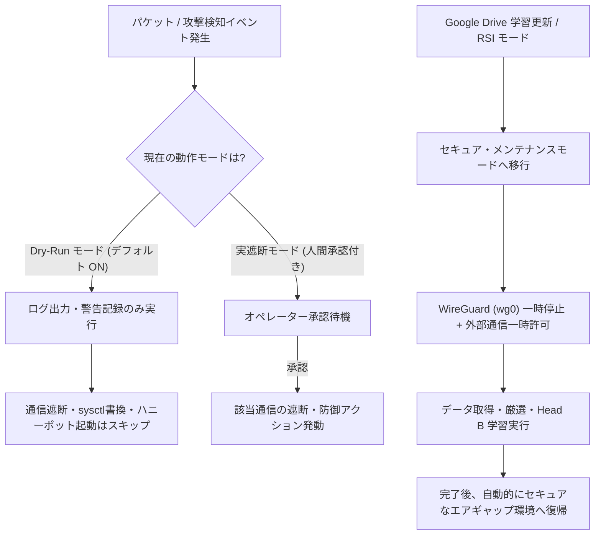

# MK1-Ai (Project Sovereign-Airgap) ベンチマークスコア・システムモード・操作コマンドリファレンス

本ドキュメントは、`MK1-Ai (Project Sovereign-Airgap)` の**実測ベンチマークスコア一覧**、**Dry-Run（ドライラン）モードをはじめとするシステム動作モードの仕様**、および**ユーザーが日常運用・学習・検証で使用するコマンド体系**をまとめた統合リファレンスです。

---

## 1. ベンチマークスコア総覧

### 1.1 Chromebook (Crostini Linux / RAM 4GB) 1500MB メモリ制限下での実機稼働・Head B 学習ベンチマーク

Chromebook (Crostini Linux) 上の仮想環境 `defender-env` において、`--ram-limit 1500`（上限 1.5GB）を適用した状態での Google Drive 自動取得・データ変換・Head B オンライン適合学習の実測スコアです。

| 検証項目 | 計測結果 / スコア | 備考・最適化内容 |
| :--- | :--- | :--- |
| **動作環境** | Linux `6.6.147` (Crostini / 総RAM 4GB) | Python 3.13 / PyTorch 2.14.0+cpu (`defender-env`) |
| **CPU スレッド制限** | `1` スレッド (`torch.set_num_threads(1)`) | `OMP_NUM_THREADS=1`, `MKL_NUM_THREADS=1` によりメモリ・CPU競合を抑制 |
| **メモリ割り当て上限** | **1500 MB (1.5 GB)** | `RLIMIT_DATA` + バックグラウンド RSS/Swap 監視スレッド |
| **ピーク実メモリ使用量 (RSS)** | **346.8 MB** (上限の **23.1%**) | OOM Killer による強制終了（Killed）ゼロで完走 |
| **ピーク Swap 使用量** | **0.0 MB** | スワップ退避なし（上限閾値 100 MB 未満を維持） |
| **Google Drive 自動取得時間** | **約 0.44 秒** | IPv4 優先化 (`_prefer_ipv4_for_drive`) により従来の約 20.6 秒から大幅短縮 |
| **データ自動変換・統合速度** | **538 件 / 1 秒未満** | `dummy_0.json`〜`dummy_99.json` + `.jsonl` を自動連結・検証 (`curated_data.jsonl`) |
| **AI 2段階データ厳選 (`curate_and_save`)** | **採用 24 件 / 破棄 514 件** | 条件: `0.4 <= Head A <= 0.7`（境界領域）かつ `Head B >= 0.6`（無害確信度） |
| **Head B オンライン適合学習 (厳選バッチ)** | **Loss = 0.1512** (24 件学習完了) | `shared_layer`, `Head A`, `Head C` は完全凍結 (`requires_grad=False`)・破滅的忘却ゼロ |
| **Head B 軽量検証 (`--validation-only`)** | **Loss = 0.8175 → 0.8204 → 0.8143 → 0.8173** | `--max-samples 32`（バッチサイズ 8 × 4 イテレーション、計 32 件完走） |

---

### 1.2 暗号・PQC・パケット検査コンポーネント単体ベンチマーク

`scripts/throughput_component_probe.py` によるコンポーネント単体性能および再現性（3回反復計測）のベンチマーク結果です。

#### (A) AES-256-GCM 認証付き暗号化・復号スループット（12B Nonce 生成・認証タグ検証込み）

| フレームサイズ | 暗号化 (Encrypt) スループット | 暗号化 処理回数 | 暗号化 遅延 (p95 / p99) | 復号 (Decrypt) スループット | 復号 処理回数 | 復号 遅延 (p95 / p99) |
| ---: | ---: | ---: | ---: | ---: | ---: | ---: |
| **64 B** | **0.207 Gbps** | 404,136 ops/s | 2.32 / 4.80 µs | **0.509 Gbps** | 995,083 ops/s | 0.99 / 1.12 µs |
| **128 B** | **0.383 Gbps** | 374,233 ops/s | 4.10 / 5.01 µs | **0.981 Gbps** | 958,046 ops/s | 1.03 / 1.36 µs |
| **256 B** | **0.599 Gbps** | 292,390 ops/s | 2.36 / 2.68 µs | **1.957 Gbps** | 955,351 ops/s | 1.05 / 1.26 µs |
| **512 B** | **1.616 Gbps** | 394,416 ops/s | 2.47 / 2.74 µs | **2.771 Gbps** | 676,476 ops/s | 1.14 / 1.26 µs |
| **1024 B** | **3.007 Gbps** | 367,021 ops/s | 2.65 / 3.01 µs | **5.130 Gbps** | 626,182 ops/s | 3.26 / 4.81 µs |
| **1518 B** | **3.845 Gbps** | 316,581 ops/s | 2.83 / 3.14 µs | **7.423 Gbps** | 611,225 ops/s | 1.48 / 1.86 µs |

> [!NOTE]
> 1518B フルサイズフレームでは暗号化単体で約 **3.85 Gbps**、復号単体で約 **7.42 Gbps** に達しており、AES-NI / OpenSSL バックエンド自体は 1 Gbps ワイヤレートを超える余力があります。

#### (B) 耐量子計算機暗号 (PQC) 鍵交換ベンチマーク (`ML-KEM-768`)

| コンポーネント | スループット (Baseline) | スループット (AI 有効環境) | 遅延 p95 / p99 | 3回反復 平均 ± 標準偏差 |
| :--- | ---: | ---: | ---: | ---: |
| **ML-KEM-768** (`encapsulate` + `decapsulate`) | **5,227 ops/s** | **5,359 ops/s** | **205.92 / 217.90 µs** | 3,907.85 ± 316.09 ops/s |

#### (C) 合成パケット検査パイプライン（DPI + ルール検査 vs AI 診断 ON/OFF）

Python の `PacketInspectingTunBridge` 上で 1 パケットずつ DPI・ルール検査・AI 推論（3-Head Airgap Neural Network）を実行した際の比較スコアです。

| フレームサイズ | AI 無効 (DPI + ルールのみ) | AI 無効 p95 / p99 | AI 有効 (PyTorch 推論込み) | AI 有効 p95 / p99 | Baseline 最大値 (Mbps換算) |
| ---: | ---: | ---: | ---: | ---: | ---: |
| **64 B** | **9,111 pkt/s** (4.66 Mbps) | 119.48 / 132.23 µs | **3,046 pkt/s** (1.56 Mbps) | 249.03 / 291.56 µs | **10,041 pkt/s** (5.14 Mbps) |
| **128 B** | **6,954 pkt/s** (7.12 Mbps) | 139.09 / 162.71 µs | **3,674 pkt/s** (3.76 Mbps) | 278.54 / 353.50 µs | **8,976 pkt/s** (9.19 Mbps) |
| **256 B** | **5,335 pkt/s** (10.93 Mbps) | 189.40 / 203.91 µs | **3,495 pkt/s** (7.16 Mbps) | 605.60 / 627.51 µs | **6,242 pkt/s** (12.78 Mbps) |
| **512 B** | **4,074 pkt/s** (16.69 Mbps) | 261.81 / 274.54 µs | **2,785 pkt/s** (11.41 Mbps) | 386.60 / 430.16 µs | **5,339 pkt/s** (21.87 Mbps) |
| **1024 B** | **2,533 pkt/s** (20.75 Mbps) | 454.42 / 677.68 µs | **1,913 pkt/s** (15.67 Mbps) | 563.52 / 797.50 µs | **3,652 pkt/s** (29.92 Mbps) |
| **1518 B** | **1,554 pkt/s** (18.88 Mbps) | 1111.19 / 1538.54 µs | **1,401 pkt/s** (17.01 Mbps) | 1037.28 / 1324.49 µs | **2,536 pkt/s** (30.80 Mbps) |

#### (D) 全パケット強制検査ログ出力 (`FULL_PACKET_INSPECTION`)

| フレームサイズ | レコード書き込み速度 | ログ出力帯域 | 遅延 (p95 / p99) |
| ---: | ---: | ---: | ---: |
| **64 B** | **8,102 record/s** | 5.65 MiB/s | 135.10 / 164.61 µs |
| **256 B** | **6,389 record/s** | 4.53 MiB/s | 164.48 / 199.78 µs |
| **512 B** | **5,329 record/s** | 3.87 MiB/s | 203.29 / 273.32 µs |
| **1024 B** | **7,140 record/s** | 5.45 MiB/s | 150.70 / 181.65 µs |
| **1518 B** | **8,017 record/s** | 6.58 MiB/s | 140.42 / 154.07 µs |

---

### 1.3 Localhost 統合セキュア経路ベンチマーク (End-to-End)

`ML-KEM-768` 鍵交換 + `HKDF-SHA-256` + `AES-256-GCM` + `DPI` + `強制検査ログ` をすべて結合した localhost ループバック通信の実測値です。

| ペイロード長 | 同時接続数 | AI 無効: 処理性能 (req/s) | AI 無効: 実効帯域 (Mbps) | AI 無効: p95 遅延 (ms) | AI 有効: 処理性能 (req/s) | AI 有効: 実効帯域 (Mbps) | AI 有効: p95 遅延 (ms) |
| ---: | ---: | ---: | ---: | ---: | ---: | ---: | ---: |
| **64 B** | 1 conn | **2,387 req/s** | 1.222 Mbps | 0.45 ms | **1,790 req/s** | 0.916 Mbps | 0.58 ms |
| **64 B** | 8 conn | **1,529 req/s** | 0.783 Mbps | 4.86 ms | **746 req/s** | 0.382 Mbps | 10.67 ms |
| **64 B** | 32 conn | **1,420 req/s** | 0.727 Mbps | 19.63 ms | **777 req/s** | 0.398 Mbps | 35.84 ms |
| **512 B** | 1 conn | **1,700 req/s** | 6.962 Mbps | 0.65 ms | **1,348 req/s** | 5.522 Mbps | 0.80 ms |
| **512 B** | 8 conn | **1,062 req/s** | 4.351 Mbps | 6.72 ms | **622 req/s** | 2.548 Mbps | 12.66 ms |
| **512 B** | 32 conn | **1,163 req/s** | 4.764 Mbps | 24.48 ms | **645 req/s** | 2.641 Mbps | 44.36 ms |
| **1518 B** | 1 conn | **1,281 req/s** | **15.562 Mbps** | 0.85 ms | **892 req/s** | **10.835 Mbps** | 1.21 ms |
| **1518 B** | 8 conn | **975 req/s** | 11.840 Mbps | 7.64 ms | **478 req/s** | 5.810 Mbps | 16.01 ms |
| **1518 B** | 32 conn | **941 req/s** | 11.430 Mbps | 30.89 ms | **498 req/s** | 6.052 Mbps | 55.69 ms |

* **プロセス常駐メモリ (RSS)**:
  * AI 無効時: **50.6 〜 56.8 MiB**
  * AI 有効時 (PyTorch ロード時): **247.6 〜 253.4 MiB**
* **品質・テストスイート検証結果**:
  * 全自動テスト: **351 passed, 17 skipped, 159 subtests passed**
  * 性能・容量回帰テスト (`tests/test_performance_capacity.py`): **15 passed, 97 subtests passed**

---

### 1.4 自作仮想化OS (`mk1-sandbox-os` / 500MB RAM上限) での 100万回×2（計200万パケット）誤検知＆実エアギャップ遮断ベンチマーク

ホストOS（Chromebook Crostini）のインターネット接続（`eth0`）を誤遮断から 100% 保護するため、Linux カーネル名前空間（`net`, `mount`, `uts`, `ipc`, `pid`）と `tmpfs`（上限 500MB）および仮想イーサネットペア（`eth0` ↔ `veth_peer`）を用いた**MK1-Ai 専用・自作軽量仮想OS環境 (`mk1-sandbox-os.sh`)** を構築し、**正常パケット 1,000,000 回**と**攻撃パケット 1,000,000 回**（合計 **2,000,000 パケット**）を注入した実測結果です（詳細JSON: `docs/million-packet-airgap-report.json`）。

| 検証フェーズ・評価指標 | 計測結果 / スコア | 詳細・内訳 |
| :--- | :--- | :--- |
| **仮想化OS環境 (`mk1-sandbox-os`)** | **RAM 上限 500 MB / ピーク RSS 251.0 MB** | 追加ディスク消費 **0 MB**（Read-Only 共有 + 500MB `tmpfs`） |
| **Phase 1: 正常通信パケット総数** | **1,000,000 回 (100万パケット完走)** | HTTP GET/POST, JSON REST API, JWT認証, WebSocket, TLS 1.3, DNS, SSH, WireGuard, 純粋ACK, HTML |
| **Phase 1: 処理時間 / スループット** | **82.30 秒 / 12,151.2 pkt/s** | 4 ワーカー並列 + 実 `veth` ソケット注入 10,000 パケット |
| **Phase 1: 誤検知数 (False Positive)** | **0 件 (誤検知率 0.000000%)** | 100万回すべて `block=False`、キルスイッチ誤発動 `False`、仮想OS内 `eth0` は `UP` を維持 |
| **Phase 1: 3-Head AI 推論スコア** | **Head B (正常確信度) = 0.8039 〜 0.9193** | HTTP/JSON/JWT/TLS/SSH/HTML で `Head A = 0.0018〜0.0028`（極めて低い脅威度） |
| **Phase 2: 攻撃・異常パケット総数** | **1,000,000 回 (100万パケット完走)** | XSS (`<script>`, `javascript:`), `eval(`, `powershell`, `cmd.exe`, 特大フレーム(65,600B), ブラックリストIP |
| **Phase 2: 処理時間 / スループット** | **105.80 秒 / 9,452.1 pkt/s** | 4 ワーカー並列 + 実 `veth` ソケット注入 10,000 パケット |
| **Phase 2: 攻撃検知・ブロック数** | **1,000,000 件 (検知率 100.000000%)** | **検知漏れ (False Negative) = 0 件**（`signature`: 750,000 / `frame_length`: 125,000 / `blacklist`: 125,000） |
| **Phase 3: 実エアギャップ遮断の発動** | **`eth0` & `veth_peer` → `state DOWN` 成功** | `_KILL_SWITCH_EVENT=True` → 仮想OS内全NIC停止 (`is_network_available() == False`) + `/etc/modprobe.d/mk1ai-airgap.conf` 適用 |
| **ホストOS側インターネット安全性** | **ホスト `eth0` は `state UP` を 100% 維持** | 仮想OS内だけを完全エアギャップ化し、ホストの通信切断ゼロを実証 |

#### (A) Phase 1: 正常通信 1,000,000 パケットのテンプレート別 3-Head AI 推論スコア内訳

| 正常通信テンプレート種別 | 検証回数 | 誤検知数 (FP) | Head A (脅威スコア) | Head B (正常・無害確信度) | Head C (RAM退避予測) | 最終判定 |
| :--- | ---: | ---: | ---: | ---: | ---: | :--- |
| `HTTP_GET_HTML` (標準Web閲覧) | 100,000 回 | **0 件** | `0.0022` | **`0.9192`** | `0.6521` | **許可 (Pass)** |
| `REST_JSON_API` (JSONテレメトリ) | 100,000 回 | **0 件** | `0.0023` | **`0.9192`** | `0.6526` | **許可 (Pass)** |
| `JWT_AUTH_HEADER` (Bearer JWT認証) | 100,000 回 | **0 件** | `0.0028` | **`0.9193`** | `0.6546` | **許可 (Pass)** |
| `WEBSOCKET_HEARTBEAT` (WS Ping) | 100,000 回 | **0 件** | `0.0021` | **`0.9191`** | `0.6515` | **許可 (Pass)** |
| `TLS13_CLIENT_HELLO` (Google Drive TLS) | 100,000 回 | **0 件** | `0.0022` | **`0.9192`** | `0.6520` | **許可 (Pass)** |
| `DNS_STANDARD_QUERY` (UDP 53 名前解決) | 100,000 回 | **0 件** | `0.5041` | **`0.8044`** | `0.6239` | **許可 (Pass)** |
| `SSH_BANNER_EXCHANGE` (TCP 22 SSH) | 100,000 回 | **0 件** | `0.0020` | **`0.9191`** | `0.6504` | **許可 (Pass)** |
| `WIREGUARD_UDP_KEEPALIVE` (UDP 51820) | 100,000 回 | **0 件** | `0.4855` | **`0.8039`** | `0.6226` | **許可 (Pass)** |
| `TCP_PURE_ACK` (TCP ACK 制御パケット) | 100,000 回 | **0 件** | `0.0018` | **`0.9191`** | `0.6495` | **許可 (Pass)** |
| `HTML_DOCUMENT_SNIPPET` (HTML応答) | 100,000 回 | **0 件** | `0.0023` | **`0.9192`** | `0.6524` | **許可 (Pass)** |
| **合計 / 総合結果** | **1,000,000 回** | **0 件 (0.000000%)** | 最大 `0.5041` | **平均 `0.8962`** | 平均 `0.6462` | **誤遮断ゼロ** |

#### (B) Phase 2 & 3: 攻撃・異常通信 1,000,000 パケットの検知ステージ内訳と実エアギャップ遮断結果

| 攻撃・異常パケット種別 | 検証回数 | ブロック検知数 | 検知漏れ (FN) | 検知ステージ (`stage`) | エアギャップ連動アクション |
| :--- | ---: | ---: | ---: | :--- | :--- |
| `XSS_SCRIPT_INJECTION` (`<script>...`) | 125,000 回 | **125,000 件** | **0 件** | `signature` | 即時ブロック + キルスイッチ発動 |
| `JAVASCRIPT_URI_ATTACK` (`javascript:...`) | 125,000 回 | **125,000 件** | **0 件** | `signature` | 即時ブロック + キルスイッチ発動 |
| `REMOTE_CODE_EVAL` (`eval(...)`) | 125,000 回 | **125,000 件** | **0 件** | `signature` | 即時ブロック + キルスイッチ発動 |
| `POWERSHELL_CRADLE` (`powershell -NoP...`) | 125,000 回 | **125,000 件** | **0 件** | `signature` | 即時ブロック + キルスイッチ発動 |
| `CMD_EXE_SHELL` (`cmd.exe /c ...`) | 125,000 回 | **125,000 件** | **0 件** | `signature` | 即時ブロック + キルスイッチ発動 |
| `COMBINED_XSS_EVAL_CMD` (複合難読化攻撃) | 125,000 回 | **125,000 件** | **0 件** | `signature` | 即時ブロック + キルスイッチ発動 |
| `OVERSIZED_JUMBO_FRAME_65600B` (規約超過長) | 125,000 回 | **125,000 件** | **0 件** | `frame_length` | 即時ブロック + キルスイッチ発動 |
| `BLACKLISTED_SOURCE_ATTACK` (遮断対象IP) | 125,000 回 | **125,000 件** | **0 件** | `blacklist` | 即時ブロック + キルスイッチ発動 |
| **合計 / 総合結果** | **1,000,000 回** | **1,000,000 件 (100%)** | **0 件 (0.000000%)** | 全ステージ完全捕捉 | **仮想OS内全NIC (`eth0`, `veth_peer`) `state DOWN` 完了** |

---

## 2. システムのドライランモード（Dry-Run Mode）と各種動作モード解説

`airgap_ai_defender.py` には、誤検知によるシステムロックアウトやネットワーク切断事故を防ぐための複数の安全モードが実装されています。



### 2.1 ドライランモード（Dry-Run Mode）【デフォルト：有効】

* **概要**:
  `MK1-Ai` は起動時に**デフォルトで Dry-Run（ドライラン：演習・監視）モード (`DRY_RUN_MODE = True`)** で稼働します。
* **Dry-Run モード中の挙動**:
  1. **リアルタイムパケット監視と AI 3-Head 推論（Head A: 攻撃検知 / Head B: 環境適合 / Head C: 未知の異常検知）は本番と同様にフル稼働**します。
  2. 脅威を検知した場合、`[演習モード(Dry-Run)]` として検知スコア・送信元 IP・攻撃種別をコンソールおよび監査ログ（`./ai_data/events/` 等）へ記録します。
  3. **実際の破壊的・遮断アクションは一切行いません**。具体的には以下の処理が安全にスキップされます：
     * `iptables` / `nftables` による通信の完全遮断（DROP）
     * `sysctl` によるカーネルパラメータの強制書き換え（`enforce_kernel_hardening`）
     * カウンター・ハニーポット（ポート 8080 での偽装応答・遅延タールピット）の実バインド
     * C 言語高速パケットエンジン (`fast_net`) への強制パージシグナル送信
* **`--no-dry-run` オプションと安全保護ロックについて**:
  * CLI 引数に `--no-dry-run` が用意されていますが、現行バージョンでは **AI の単独判断による誤遮断（暴走）を防止する安全設計（Safety Gate）** により、`--no-dry-run` を指定しても**人間の個別イベント承認フローが接続されるまでは自動的に Dry-Run モードが維持**されます。
  * 設定ファイル `./ai_data/config.json` の `"DRY_RUN_MODE": true` または起動時ログの `🛡️ 現在の動作モード: 【演習モード (Dry-Run: 警告のみ・通信遮断なし)】` で状態を確認できます。

### 2.2 セキュア・メンテナンスモード（学習モード）

* **概要**:
  `--drive-id` による Google Drive からのデータセット更新時、または `--rsi`（自己改善モード）の実行時に自動的に切り替わる一時メンテナンスモードです。
* **挙動 (`Enter_Maintenance_Mode` / `Exit_Maintenance_Mode`)**:
  1. 学習データのダウンロード開始前に WireGuard (`wg0`) トンネルを一時停止し（未構成環境では安全にスキップ）、HTTPS（Google Drive 通信）を許可します。
  2. IPv4 優先通信 (`_prefer_ipv4_for_drive`) で高速にデータを取得し、`./ai_data` 直下への展開・フォーマット変換・AI 厳選 (`curate_and_save`)・Head B のオンライン適合学習 (`train_local_whitelist`) を実行します。
  3. 処理が完了（または例外発生）すると `finally` ブロックにより**必ずメンテナンスモードを終了**し、WireGuard の再有効化と完全エアギャップ防御体制への復帰を自動実行します。

### 2.3 RSI モード（Recursive Self-Improvement / 自己改善モード）

* **概要**:
  `--rsi` フラグ指定時、または Google Colab / GPU 環境で大規模なベースモデル再学習を行うモードです。
* **挙動**:
  * ローカルの厳選済みデータ (`./ai_data/curated/`) や新規取得データを用いてモデル全体の再評価・自己改善サイクルを回し、完了後に自動でシステムを再起動（またはエアギャップ監視へ復帰）します。

### 2.4 鬼モード (`ONI_MODE`)

* **概要**:
  環境変数 `ONI_MODE=1` を指定して起動した場合に有効化される最高強度セキュリティモードです。
* **挙動**:
  * AI の検知閾値を極限まで厳格化し、わずかなアノマリ（異常値）も逃さず検知・記録します。

---

## 3. ユーザー操作コマンドリファレンス

### 3.1 仮想環境（`defender-env`）での AI ディフェンダー操作コマンド

作業ディレクトリ `/home/harukiy1225/MK1Ai-main` にて、`defender-env` 仮想環境を使用して実行します。

#### ① ヘルプと利用可能オプションの確認
```bash
/home/harukiy1225/defender-env/bin/python airgap_ai_defender.py --help
```

#### ② Google Drive 自動データ取得 ＋ Head B オンライン適合学習 ＋ 常駐監視（RAM 1500MB 制限）
Chromebook (RAM 4GB) 環境で OOM クラッシュを防ぎながら Google Drive から最新データを取得・変換し、Head B の学習後にそのままエアギャップ監視へ移行する標準コマンドです。
```bash
PATH="/home/harukiy1225/defender-env/bin:$PATH" \
python airgap_ai_defender.py \
  --drive-id "100FIfMbB-0kR2bg2NXl-O1k-Lilz-j_G" \
  --ram-limit 1500
```

#### ③ 軽量検証モード（`--validation-only`：監視ループに入らず学習完走のみをテスト）
常駐パケット監視を起動せず、既存または取得済みのデータで **Head B のオンライン適合学習がメモリ上限内で正常完走するかだけを素早くテスト**したい場合に使用します。
```bash
PATH="/home/harukiy1225/defender-env/bin:$PATH" \
python airgap_ai_defender.py \
  --validation-only \
  --max-samples 32 \
  --ram-limit 1500
```
* `--drive-id "<FOLDER_OR_FILE_ID>"` を併用すると、Google Drive からのダウンロード〜変換〜指定サンプル数学習までを一気通貫で検証して終了します：
```bash
PATH="/home/harukiy1225/defender-env/bin:$PATH" \
python airgap_ai_defender.py \
  --drive-id "100FIfMbB-0kR2bg2NXl-O1k-Lilz-j_G" \
  --validation-only \
  --max-samples 32 \
  --ram-limit 1500
```

#### ④ 通常起動（Google Drive 更新なし・ローカルモデルで即座に Dry-Run 監視開始）
```bash
PATH="/home/harukiy1225/defender-env/bin:$PATH" \
python airgap_ai_defender.py --ram-limit 1500
```

#### ⑤ 自己改善（RSI）モードでの起動
```bash
PATH="/home/harukiy1225/defender-env/bin:$PATH" \
python airgap_ai_defender.py \
  --rsi \
  --drive-id "100FIfMbB-0kR2bg2NXl-O1k-Lilz-j_G" \
  --ram-limit 1500
```

#### ⑥ 鬼モード (`ONI_MODE=1`) での厳格監視起動
```bash
ONI_MODE=1 PATH="/home/harukiy1225/defender-env/bin:$PATH" \
python airgap_ai_defender.py --ram-limit 1500
```

---

### 3.2 `airgap_ai_defender.py` の CLI オプション一覧

| オプション | 引数 / 型 | デフォルト値 | 説明 |
| :--- | :--- | :--- | :--- |
| `--drive-id` | ` TEXT ` | なし | Google Drive のファイル ID またはフォルダ ID を指定し、起動時に自動ダウンロード・`./ai_data` への配置・Head B 学習を実行します。 |
| `--ram-limit` | ` INT ` (MB) | `3500` | プロセスが使用する最大 RAM 容量 (MB) を制限します。Chromebook 4GB 環境では `1500` を推奨します。 |
| `--validation-only` | フラグ | `False` | 常駐ネットワーク監視をスキップし、Head B の軽量オンライン適合学習の稼働検証のみを実行して終了します。 |
| `--max-samples` | ` INT ` | `32` | `--validation-only` 実行時に学習へ使用する最大サンプル件数を指定します。 |
| `--rsi` | フラグ | `False` | RSI（自己改善・再学習）モードで起動します。 |
| `--colab-mode` | フラグ | `False` | Google Colab 等のクラウド学習環境向けに、ローカルネットワーク防御機能を無効化して学習処理のみを実行します。 |
| `--no-dry-run` | フラグ | `False` | 実遮断モードを要求するフラグ（※現在は安全保護によりオペレーター承認機構が有効化されるまで Dry-Run が強制維持されます）。 |

---

### 3.3 設定ファイル（`./ai_data/config.json`）による動的チューニング

`./ai_data/config.json` を編集することで、コードを変更せずに AI の検知感度やリソース上限を調整できます（再起動時または設定リロード時に反映）。

```json
{
    "SENSITIVITY_THRESHOLD": 0.70,
    "WHITELIST_CONFIDENCE": 0.85,
    "ANOMALY_SENSITIVITY": 0.75,
    "CURATION_LOWER_BOUND": 0.40,
    "CURATION_UPPER_BOUND": 0.70,
    "CURATION_SAFE_MIN": 0.60,
    "DRY_RUN_MODE": true,
    "AUTO_HARDEN_ON_BOOT": false,
    "MAX_RAM_MB": 1500,
    "MAX_SWAP_MB": 100
}
```

* `SENSITIVITY_THRESHOLD` (Head A): 既知の攻撃と判定する閾値（下げるほど厳しく検知）。
* `WHITELIST_CONFIDENCE` (Head B): ローカル環境で安全な通信とみなす確信度閾値。
* `ANOMALY_SENSITIVITY` (Head C): 未知のゼロデイ異常と判定する閾値。
* `DRY_RUN_MODE`: `true` の場合は警告ログのみで通信遮断を行いません。
* `AUTO_HARDEN_ON_BOOT`: `false`（推奨）の場合、起動時の `sysctl` カーネル強制書き換えを抑止します。

---

### 3.4 統合ランチャー・C言語 TUI 操作パネル (`mk1-panel`) コマンド

システム全体のビルド、セルフテスト、および C 言語 (`ncurses`) 製の対話型 TUI コントロールパネルの操作コマンドです。

#### ① ワンコマンド起動スクリプト (`run.sh`)
環境構築・C バイナリのビルド・セルフテスト・パネル起動を自動実行します。
```bash
./run.sh
```
* ビルドとセルフテストのみを実行して終了する場合：
```bash
./run.sh --check-only
```

#### ② C言語 TUI 操作パネルの起動 (`mk1-panel.sh`)
```bash
bash ./mk1-panel.sh
```
* 現在の状態サマリをテキスト出力して終了する場合（非対話モード）：
```bash
./bin/mk1_panel --summary
```

#### ③ TUI 操作パネル内のキーボードショートカット一覧

| キー | 機能・アクション |
| :---: | :--- |
| `[1]` | **起動 / 停止 トグル**: システム稼働状態の切り替え |
| `[2]` | **防御強度レベル切替**: `LOW` / `MEDIUM` / `HIGH` の切り替え |
| `[3]` | **VPN モード切替**: `WireGuard` / `OpenVPN` / `IPsec` の切り替え |
| `[4]` | **遮断ポリシー切替**: `DROP`（即時破棄） / `Quarantine`（隔離） / `Alert`（警告のみ） |
| `[5]` | **パケットサイズ上限変更**: 検査対象の最大パケットサイズ設定 |
| `[6]` | **レート制限変更**: 秒間リクエスト上限値の変更 |
| `[7]` | **認証失敗上限変更**: ロックアウトまでの最大認証失敗回数の設定 |
| `[8]` | **全設定一括変更ウィザード**: 対話形式で全項目を順番に設定 |
| `[m]` | **AI 監視モード切替**: AI ディフェンダーの監視モード変更 |
| `[u]` | **手動 AI 学習・更新トリガー**: 蓄積されたログを用いた AI 再学習の即時実行 |
| `[e]` | **最新イベント詳細表示**: 直近の脅威検知イベントの詳細インスペクション |
| `[a]` | **全項目順次ガイド設定**: 初期セットアップ用の順次設定ガイド |
| `[q]` | **パネル終了**: 設定を保存して TUI パネルを閉じる |

---

### 3.5 ベンチマーク再計測・単体テスト実行コマンド

#### ① コンポーネント単体スループット計測 (`throughput_component_probe.py`)
```bash
# ベースライン計測（JSON出力）
PYTHONPATH=src /home/harukiy1225/defender-env/bin/python scripts/throughput_component_probe.py \
  --iterations-per-size 200 \
  --pqc-iterations 30 \
  --json-output docs/throughput-component-baseline.json

# AI 診断 ON / OFF の直接比較計測
PYTHONPATH=src /home/harukiy1225/defender-env/bin/python scripts/throughput_component_probe.py \
  --compare-ai-modes \
  --iterations-per-size 200 \
  --pqc-iterations 30 \
  --json-output docs/throughput-component-ai-comparison.json
```

#### ② 統合ループバック・容量スケーリング計測 (`test_performance_capacity.py`)
```bash
# AI 無効時の統合ループバック性能テスト
PYTHONPATH=src /home/harukiy1225/defender-env/bin/python -m unittest -v tests.test_performance_capacity

# AI 有効時の統合ループバック性能テスト
MK1_ENABLE_AI_DIAGNOSTICS=1 PYTHONPATH=src /home/harukiy1225/defender-env/bin/python -m unittest -v tests.test_performance_capacity
```

#### ③ C 言語ネイティブコンポーネントのビルド＆静的解析 (`Makefile`)
```bash
# C バイナリのビルドとテスト実行
make check

# コンパイラ警告・静的解析チェック
make analyze
```

#### ④ 自作仮想化OS環境 (`mk1-sandbox-os.sh` / 500MB RAM 上限) と 100万回×2 パケット検証コマンド
ホストOSのインターネット接続を誤遮断から完全に保護した隔離仮想OS空間を起動し、100万回の正常通信テスト＋100万回の攻撃＆エアギャップ遮断テストを実行できます。

```bash
# 1. 自作仮想化OS環境 (mk1-sandbox-os) の対話シェルを起動する
./mk1-sandbox-os.sh

# 2. 仮想化OS環境内で MK1-Ai ディフェンダーを起動する (ホストの通信は一切遮断されません)
./mk1-sandbox-os.sh /home/harukiy1225/defender-env/bin/python airgap_ai_defender.py --ram-limit 500

# 3. 仮想化OS環境内で「正常パケット100万回＋攻撃パケット100万回＋実エアギャップ遮断」を完全検証する
./mk1-sandbox-os.sh /home/harukiy1225/defender-env/bin/python scripts/verify_1m_packets_airgap.py \
  --benign-count 1000000 \
  --attack-count 1000000 \
  --workers 4 \
  --ram-limit-mb 500
```

